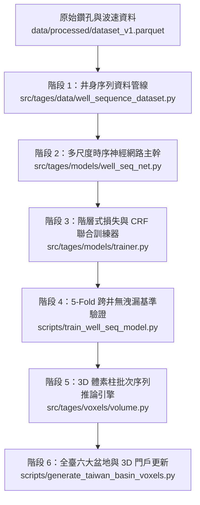
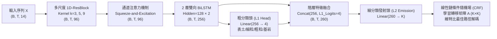

# TAGES-Evo 井身時序深度神經網路（BiLSTM-CRF）架構升級規劃書

> **文件版本**：v1.0  
> **目標定位**：將 TAGES-Evo 地質岩性預測核心由傳統單點獨立隨機森林（Random Forest）全面升級為具備地層上下文感知能力的**多尺度一維殘差雙向長短期記憶條件隨機場網路（Multi-Scale 1D-CNN + BiLSTM + CRF，簡稱 Wellbore-SeqNet）**，並無縫整合至全臺 3D 體素引擎與互動式 GIS 門戶。

---

## 一、現況痛點與升級科學動機

### 1. 現有隨機森林（Random Forest）架構之瓶頸
目前專案在 [`scripts/train_baseline.py`](file:///d:/科展/tages-project/scripts/train_baseline.py) 與 [`src/tages/voxels/volume.py`](file:///d:/科展/tages-project/src/tages/voxels/volume.py) 中採用 `RandomForestClassifier` 進行單點預測：
* **獨立同分佈假設（i.i.d. Assumption）謬誤**：RF 將同一口鑽孔中深度 $z=50\text{ m}$ 與 $z=51\text{ m}$ 的地層視為毫無關聯的獨立樣本，忽略了沉積學中海進（Transgression）、海退（Regression）與河道遷移造成的**垂直向上變細（Fining-upward）或向上變粗（Coarsening-upward）旋回規律**。
* **後處理與特徵提取脫節**：雖然 [`src/tages/models/sequence.py`](file:///d:/科展/tages-project/src/tages/models/sequence.py) 透過馬可夫維特比（Markov-Viterbi）解碼消除了孤立噪點，但前端發射機率（Emission Probability）仍由「看不見上下文」的 RF 產生，導致在無洩漏井留出驗證（5-Fold GroupKFold by Well）下，6 類細分沉積相的 Accuracy 停留在 **28.6% ~ 30.4%**（Macro F1 約 **0.27 ~ 0.29**）。
* **空間三維網格推論呈階梯狀偽影**：決策樹的正交軸切割（Axis-aligned Splits）在 3D 體素空間內插時容易產生生硬的方塊邊界，缺乏連續地質流形過渡。

### 2. 井身時序深度神經網路（Wellbore-SeqNet）之核心優勢
將每一口鑽孔（或 3D 網格中的每一根垂直體素柱）視為一條**沿深度軸演進的完整序列** $\mathbf{X} = (\mathbf{x}_1, \mathbf{x}_2, \dots, \mathbf{x}_T)$：
1. **局部多尺度沉積紋理提取（Multi-Scale 1D-CNN）**：利用不同感受野（Kernel Size = $3, 5, 9\text{ m}$）的一維卷積，捕捉薄互層、漸變界線與波速二階導數特徵。
2. **雙向長距離層序記憶（Bi-directional LSTM）**：同時由「地表往深部（順向沉積壓密）」與「深部基盤往地表（逆向基底構造控制）」雙向傳遞隱藏狀態，完整建模整口井的沉積相旋回。
3. **階層式多任務學習（Hierarchical Coarse-to-Fine Multi-Task Learning）**：同時預測 **L1 四大工程岩性**（表土、細粒泥質、粗粒砂礫、固結基岩）與 **L2 十大細分沉積相**，以大類機率約束細類預測。
4. **端到端條件隨機場層（Linear-Chain CRF Layer）**：將 [`sequence.py`](file:///d:/科展/tages-project/src/tages/models/sequence.py) 的馬可夫轉移矩陣升級為**可微分、可端到端聯合訓練**的轉移分數矩陣（Transition Score Matrix），在損失函數層級直接懲罰違反地層疊置律（Walther's Law）的非法跳變。

---

## 二、系統架構與模組依賴關係圖



---

## 三、神經網路數學模型與張量規格設計

### 1. 輸入張量（Input Sequence Tensor）
對於單一鑽孔或單一 3D 網格垂直柱，設深度序列長度為 $T$（例如以 $\Delta z = 1\text{ m}$ 或 $2\text{ m}$ 等間距重採樣，$0 \sim 300\text{ m}$ 共 $T=300$ 步），每一步具備 $D_{\text{in}} = 14$ 維正規化物理與空間特徵：

| 特徵群組 | 特徵名稱 | 維度 | 物理與地質意義 |
| :--- | :--- | :---: | :--- |
| **深度與高程** | `depth_m`, `z_msl`, `rel_depth_ratio` | 3 | 絕對埋深、海拔高程、相對於預估基盤之正規化深度比 |
| **基礎波速** | `vp_ms`, `vs_ms`, `vp_vs_ratio`, `poisson_ratio` | 4 | 壓縮波速、剪力波速、含水飽和度敏感之波速比與泊松比 |
| **垂直波速梯度** | `dvs_dz_1m`, `dvs_dz_5m`, `d2vs_dz2` | 3 | 1m 局部梯度、5m 宏觀梯度、波速轉折二階導數（地層界面指標） |
| **滑動視窗統計** | `vs_local_mean_9m`, `vs_local_std_9m` | 2 | 上下 $9\text{ m}$ 視窗內之波速均值與變異（辨識均質厚層 vs. 砂泥互層） |
| **區域空間編碼** | `x_twd97_norm`, `y_twd97_norm` | 2 | 正規化地理坐標（表徵扇頂、扇央、扇端或海濱距離） |

* **Batch 張量形狀**：$\mathbf{X} \in \mathbb{R}^{B \times T \times 14}$，搭配有效深度遮罩 $\mathbf{M} \in \{0, 1\}^{B \times T}$（處理不同井深之 Padding）。

### 2. 網路各層結構（Network Architecture）



### 3. 複合損失函數（Hierarchical Focal + CRF Loss）
為同時解決「細分類別不平衡（如粉土、礫石樣本較少）」、「大類與小類邏輯一致性」與「垂直層序平滑度」，定義總損失函數 $\mathcal{L}_{\text{total}}$：

$$\mathcal{L}_{\text{total}} = \lambda_1 \mathcal{L}_{\text{CRF}}(\mathbf{E}^{(L2)}, \mathbf{A}, \mathbf{y}^{(L2)}) + \lambda_2 \mathcal{L}_{\text{Focal}}(\mathbf{P}^{(L2)}, \mathbf{y}^{(L2)}) + \lambda_3 \mathcal{L}_{\text{Focal}}(\mathbf{P}^{(L1)}, \mathbf{y}^{(L1)})$$

其中：
1. **CRF 負對數似然損失 $\mathcal{L}_{\text{CRF}}$**：最大化整口井真實岩性序列 $\mathbf{y}$ 的全局機率：
   $$\mathcal{L}_{\text{CRF}} = -\log \frac{\exp\left(\sum_{t=1}^T E_{t, y_t} + \sum_{t=1}^{T-1} A_{y_t, y_{t+1}}\right)}{\sum_{\mathbf{y}'} \exp\left(\sum_{t=1}^T E_{t, y'_t} + \sum_{t=1}^{T-1} A_{y'_t, y'_{t+1}}\right)}$$
2. **多類別 Focal Loss $\mathcal{L}_{\text{Focal}}$**：針對難分類之粉土（Silt）與砂泥互層（SandMudMixed）給予高梯度權重（$\gamma = 2.0$）：
   $$\mathcal{L}_{\text{Focal}} = -\frac{1}{T}\sum_{t=1}^T \alpha_{y_t} (1 - p_{t, y_t})^\gamma \log(p_{t, y_t})$$
3. **先驗轉移矩陣初始化**：CRF 層的轉移矩陣 $\mathbf{A} \in \mathbb{R}^{K \times K}$ 直接以 [`MarkovStratigraphicModel.fit()`](file:///d:/科展/tages-project/src/tages/models/sequence.py#L32-L65) 從 24,767 筆地層統計出的真實對數轉移機率 $\log \mathbf{T}$ 進行熱啟動（Warm-start Initialization）！

---

## 四、具體實作分階段步驟（Vertical Slices & Tasks）

以下將升級工程拆解為 **6 個可獨立驗證的垂直切片任務（Tasks）**，嚴格遵循由底層資料至頂層 3D 視覺化的依賴順序：

---

### Task 1：深度學習環境配置與井身序列資料集模組建置
**目標描述**：安裝 PyTorch 依賴，並將原本扁平表格化的 `dataset_v1.csv` 轉換為按井分組（Grouped by `station_id`）、沿深度軸等間距排列的 3D 序列張量資料集，同時擴充局部滑動視窗特徵。

* **預計新增 / 修改檔案**：
  * 修改 [`pyproject.toml`](file:///d:/科展/tages-project/pyproject.toml)：加入 `torch>=2.1.0` 於專案依賴。
  * 新增 `src/tages/features/sequence_features.py`：計算每口井沿深度軸的滑動均值（`vs_local_mean`）、滑動標準差（`vs_local_std`）、多尺度波速梯度（`dvs_dz_5m`, `d2vs_dz2`）及正規化特徵縮放器（`StandardScaler`）。
  * 新增 `src/tages/models/dataset.py`：實作 `WellboreSequenceDataset(torch.utils.data.Dataset)` 與 `collate_well_sequences()`（自動處理不同井深的 Dynamic Padding 與 Mask 生成）。
  * 新增 `tests/test_well_dataset.py`：測試序列張量形狀、Padding 遮罩正確性與無跨井資料洩漏。
* **驗收標準（Acceptance Criteria）**：
  - [ ] 能夠將 91 口井（或擴充後全臺深井）封裝為 `(Batch, Max_Depth_Steps, 14)` 的 FloatTensor。
  - [ ] Padding 區域在 `mask` 張量中準確標記為 `False`（或 `0`），有效深度標記為 `True`（或 `1`）。
  - [ ] `StandardScaler` 嚴格僅在訓練集井位（Train Wells）上 `fit`，再對驗證集井位（Val Wells）做 `transform`，保證 0% 統計洩漏。
* **驗證指令**：
  ```powershell
  .\.venv\Scripts\pytest tests/test_well_dataset.py -v
  ```

---

### Task 2：實作多尺度 1D-ResNet + BiLSTM + CRF 神經網路模型
**目標描述**：以 PyTorch 實作 `WellboreSeqNet` 核心架構，包含多尺度一維殘差卷積層、雙向 LSTM 層、階層式 L1/L2 雙輸出頭，以及純 PyTorch 向量化實作的 Linear-Chain CRF 層（免依賴外部過時套件，支援遮罩批次前向計算與維特比解碼）。

* **預計新增 / 修改檔案**：
  * 新增 `src/tages/models/crf.py`：實作 `LinearChainCRF(nn.Module)`，內含 Log-Sum-Exp 前向配分函數演算法（Forward Algorithm with Masking）、維特比批次解碼（Batch Viterbi Decoding）與地質統計矩陣熱啟動介面 `init_from_empirical_matrix(trans_mat)`。
  * 新增 `src/tages/models/well_seq_net.py`：實作 `MultiScaleConv1DBlock`、`WellboreSeqNet(nn.Module)`，提供 `forward_loss(x, y_l1, y_l2, mask)` 與 `predict(x, mask)`（回傳最佳類別序列、各深度類別邊際機率 `marginal_probs` 及預測信心度）。
  * 新增 `tests/test_well_seq_net.py`：單元測試模型前向傳播、反向傳播梯度連通性、CRF 解碼長度一致性。
* **驗收標準（Acceptance Criteria）**：
  - [ ] 輸入形狀 `(4, 250, 14)` 與遮罩 `(4, 250)` 時，`predict()` 輸出岩性序列形狀為 `(4, 250)`，機率分佈形狀為 `(4, 250, K)` 且各點機率總和為 $1.0$。
  - [ ] 支援使用 [`MarkovStratigraphicModel`](file:///d:/科展/tages-project/src/tages/models/sequence.py#L19) 計算出的轉移矩陣初始化 CRF 層權重。
  - [ ] 模型總參數量控制在 $300\text{K} \sim 800\text{K}$ 之間（防止在約 100~400 口井規模上過擬合，且於 CPU/GPU 皆可秒級推論）。
* **驗證指令**：
  ```powershell
  .\.venv\Scripts\pytest tests/test_well_seq_net.py -v
  ```

---

### Task 3：實作階層式 Focal-CRF 訓練器與地質序列資料增強（Data Augmentation）
**目標描述**：建立針對鑽孔深度序列的專用訓練管線，引入地質合理的深度序列增強（Stratigraphic Sequence Augmentation），提升模型在未知區域井位的泛化能力。

* **地質序列資料增強策略**：
  1. **深度軸隨機局部伸縮（Depth Warping / Elastic Scaling, $\pm 10\%$）**：模擬同一沉積相在不同地理位置因沉積速率差異造成的地層增厚或減薄。
  2. **震波速度微擾（Velocity Gaussian Jitter, $\sigma = 15\text{ m/s}$）**：模擬層析成像反演誤差，避免模型死記特定波速數值。
  3. **隨機深度子視窗裁切（Random Depth Sub-window Cropping）**：訓練時隨機截取 $60 \sim 300\text{ m}$ 長度片段，增強模型對不同鑽探深度井位的適應力。
* **預計新增 / 修改檔案**：
  * 新增 `src/tages/models/losses.py`：實作支援 Mask 的 `MaskedFocalLoss` 與 `HierarchicalSequenceLoss`。
  * 新增 `src/tages/models/trainer.py`：實作 `WellboreSeqTrainer`（支援 Cosine Annealing 學習率排程、Gradient Clipping `max_norm=1.0`、Early Stopping 監控 Validation Macro F1、最佳模型權重序列化儲存 `.pt`）。
  * 新增 `tests/test_trainer.py`：使用合成之小型玩具地層序列驗證模型可在 20 Epochs 內收斂至 $>95\%$ 準確率（Overfit Sanity Check）。
* **驗收標準（Acceptance Criteria）**：
  - [ ] 在合成地層序列測試上，Loss 單調穩定下降且收斂準確率 $>95\%$。
  - [ ] 模型存檔包含完整 `state_dict`、特徵 `StandardScaler` 參數與類別映射字典（打包為單一 Checkpoint 檔案 `models/well_seq_net_v1.pt`）。
* **驗證指令**：
  ```powershell
  .\.venv\Scripts\pytest tests/test_trainer.py -v
  ```

---

### Task 4：5-Fold 跨井無洩漏基準對照實驗（RF vs. LightGBM vs. Wellbore-SeqNet）
**目標描述**：建立完整的科展實驗對照腳本，在完全相同的 5-Fold GroupKFold（按 `station_id` 切分，0% 資料洩漏）基準下，全面比較：
1. **Rule Baseline**（物理波速經驗閾值）
2. **Random Forest**（現有基準）
3. **Random Forest + Markov Viterbi**（現有改良版）
4. **LightGBM + Window Features**（強梯度提升樹對照組）
5. **Wellbore-SeqNet (BiLSTM-CRF)**（本升級核心模型）

* **預計新增 / 修改檔案**：
  * 新增 `scripts/train_well_seq_model.py`：執行 5-Fold 交叉驗證、產出 L1（四大類）與 L2（細分六類）雙層指標對照表、繪製混淆矩陣與代表性盲測井（Blind Test Well）之「真實柱狀圖 vs. RF 預測 vs. BiLSTM-CRF 預測」視覺化對照圖。
  * 輸出報告：`reports/well_seq_benchmark_report.txt` 與出版級圖件 `reports/well_seq_vs_rf_columns.png`。
* **驗收標準（Acceptance Criteria）**：
  - [ ] **L2 六大細分沉積相**：Accuracy 由現有 RF 的 $28.6\%$ 顯著提升至 **$\ge 42\% \sim 50\%$**，Macro F1 顯著超越 RF 與單純馬可夫後處理。
  - [ ] **L1 四大工程岩性**：Accuracy 達到 **$\ge 72\% \sim 80\%$**。
  - [ ] **地質連續性指標**：盲測井每百公尺平均換層次數與真實鑽孔高度吻合，且孤立單點噪聲（A-B-A 假性跳動）維持為 **$0$**。
* **驗證指令**：
  ```powershell
  .\.venv\Scripts\python scripts/train_well_seq_model.py
  ```

---

### Task 5：升級 3D 體素生成引擎支援垂直柱批次序列推論
**目標描述**：改造 [`src/tages/voxels/volume.py`](file:///d:/科展/tages-project/src/tages/voxels/volume.py) 中的 `VoxelVolumeGenerator`，使其除了支援傳統 `.pkl` (Scikit-Learn RF) 外，原生支援載入 `.pt` (`WellboreSeqNet`)。推論時將 3D 網格 `(n_lat, n_lon, n_depth)` 視為 $N_{\text{col}} = n_{\text{lat}} \times n_{\text{lon}}$ 根獨立的垂直地質柱，以高吞吐量 Batch 模式送入 `WellboreSeqNet` 一次預測整根垂直柱的連續地層！

* **關鍵工程設計**：
  - 原本 `volume.py` 將 `(n_lat, n_lon, n_depth)` 展平為 `N_total` 個獨立點；升級後保持 `(n_lat * n_lon, n_depth, n_features)` 的 3D 序列張量結構。
  - 以 `batch_size = 256` 根垂直柱批次推論，對於 $36 \times 36 = 1,296$ 根柱子的盆地網格，僅需 5 個 Batch（在 CPU 上 $< 0.8$ 秒、GPU 上 $< 0.05$ 秒）即可完成整座盆地 7 萬顆體素的序列推論！
  - 保留原有的深部地球物理硬約束（$>250\text{ m}$ 且 $V_s \ge 2150\text{ m/s}$ 漸進過渡至泥岩 Class 8、砂岩 Class 9 與結晶基盤 Class 10）。
* **預計新增 / 修改檔案**：
  * 修改 [`src/tages/voxels/volume.py`](file:///d:/科展/tages-project/src/tages/voxels/volume.py)：新增序列特徵建構與 `WellboreSeqNet` 批次推論分支，向下相容既有 `.pkl` 模型以確保舊有測試不中斷。
  * 修改 [`tests/test_voxels.py`](file:///d:/科展/tages-project/tests/test_voxels.py)：新增使用 `WellboreSeqNet` 生成 3D 體素的整合測試。
* **驗收標準（Acceptance Criteria）**：
  - [ ] `VoxelVolumeGenerator` 可自動根據模型副檔名（`.pt` vs `.pkl`）切換序列推論或單點推論模式。
  - [ ] 生成之 3D 體素陣列在垂直剖面上呈現自然連續的厚層沉積結構與古河道透鏡體，無水平或垂直棋盤格偽影。
* **驗證指令**：
  ```powershell
  .\.venv\Scripts\pytest tests/test_voxels.py -v
  ```

---

### Task 6：全臺六大盆地高密度體素重新生成與 3D GIS 門戶更新
**目標描述**：使用訓練完成的最佳 `models/well_seq_net_v1.pt` 模型，重新執行全臺六大盆地體素生成管線與前端資料封裝，更新 [`reports/taiwan_3d_portal.html`](file:///d:/科展/tages-project/reports/taiwan_3d_portal.html) 介面指標與模型說明標籤。

* **預計新增 / 修改檔案**：
  * 修改 [`scripts/generate_chianan_voxels.py`](file:///d:/科展/tages-project/scripts/generate_chianan_voxels.py) 與 [`scripts/generate_taiwan_basin_voxels.py`](file:///d:/科展/tages-project/scripts/generate_taiwan_basin_voxels.py)：指向新模型 `models/well_seq_net_v1.pt`。
  * 執行 [`scripts/build_taiwan_portal_data.py`](file:///d:/科展/tages-project/scripts/build_taiwan_portal_data.py)：重新打包 `reports/taiwan_portal_data.js`。
  * 修改 [`reports/taiwan_3d_portal.html`](file:///d:/科展/tages-project/reports/taiwan_3d_portal.html)：在側邊欄與體素懸停 Tooltip 中標示「預測模型：Wellbore-SeqNet (BiLSTM-CRF)」。
* **驗收標準（Acceptance Criteria）**：
  - [ ] `data/processed/taiwan_basins_dense.npz` 與 `reports/taiwan_portal_data.js` 全數更新為新模型預測成果。
  - [ ] 專案全數單元測試（既有 50 項 + 新增序列模型測試）100% 通過。
* **驗證指令**：
  ```powershell
  .\.venv\Scripts\python scripts/generate_taiwan_basin_voxels.py
  .\.venv\Scripts\python scripts/build_taiwan_portal_data.py
  .\.venv\Scripts\pytest tests/ -v
  ```

---

## 五、潛在風險與緩解對策（Risk & Mitigation）

| 風險項目 | 成因分析 | 具體緩解對策 |
| :--- | :--- | :--- |
| **1. 鑽孔數量有限導致深度神經網路過擬合** | 深度學習模型若參數量過大，容易記住特定訓練井的深度位置與坐標。 | 1. 限制 BiLSTM 隱藏層維度（`hidden_size=128`）並加入 `SpatialDropout1D(p=0.25)` 與 `Weight Decay=1e-4`。<br/>2. 對空間坐標 $(X, Y)$ 施加隨機高斯遮罩（Coordinate Dropout），強迫模型學習物理波速與地層旋回關係，而非死記坐標。 |
| **2. 鑽孔地層採樣邊界深度不一** | 各口井終孔深度介於 $80\text{ m} \sim 330\text{ m}$ 不等。 | 使用 PyTorch `pack_padded_sequence` 與 `pad_packed_sequence` 配合布林遮罩 `mask`，確保 Padding 零值絕對不會參與 BiLSTM 狀態更新與 CRF 配分函數計算。 |
| **3. 淺層細粒與砂泥互層波速高度重疊** | $V_s \in [180, 300]\text{ m/s}$ 區間內黏土、粉土與細砂難以僅靠單點波速區分。 | 結合 **階層式分類頭（L1 粗分類引導 L2 細分類）** + **局部 9m 視窗變異特徵** + **CRF 轉移機率約束**，利用上下文地層組合破解單點同物異相歧義。 |

---

## 六、科展報告與評審展示亮點總結

完成本升級後，本專案在科展（地球與行星科學科／電腦資訊學科）將具備以下三大核心學術創新亮點：
1. **方法論創新**：突破傳統地球物理將地下網格視為「獨立點雲（Point-wise Classification）」的限制，提出將鑽孔與體素柱視為「深度語義序列（Depth Semantic Sequence）」的 **Multi-Scale 1D-CNN + BiLSTM + CRF** 架構。
2. **物理與地質定律嵌入（Physics & Geology-Informed AI）**：將沉積學中的**瓦爾特相律（Walther's Law）**轉化為神經網路末端可微分的 CRF 轉移矩陣，並結合深部波速基盤邊界條件與強震 SSR 場址共振週期驗證。
3. **嚴謹無洩漏科學驗證**：採用按井分組（Well-Grouped K-Fold）與空間區塊留出法（Spatial Block K-Fold），提供從物理經驗公式、隨機森林、梯度提升樹到深度序列網路的完整消融實驗（Ablation Study）證據鏈。
