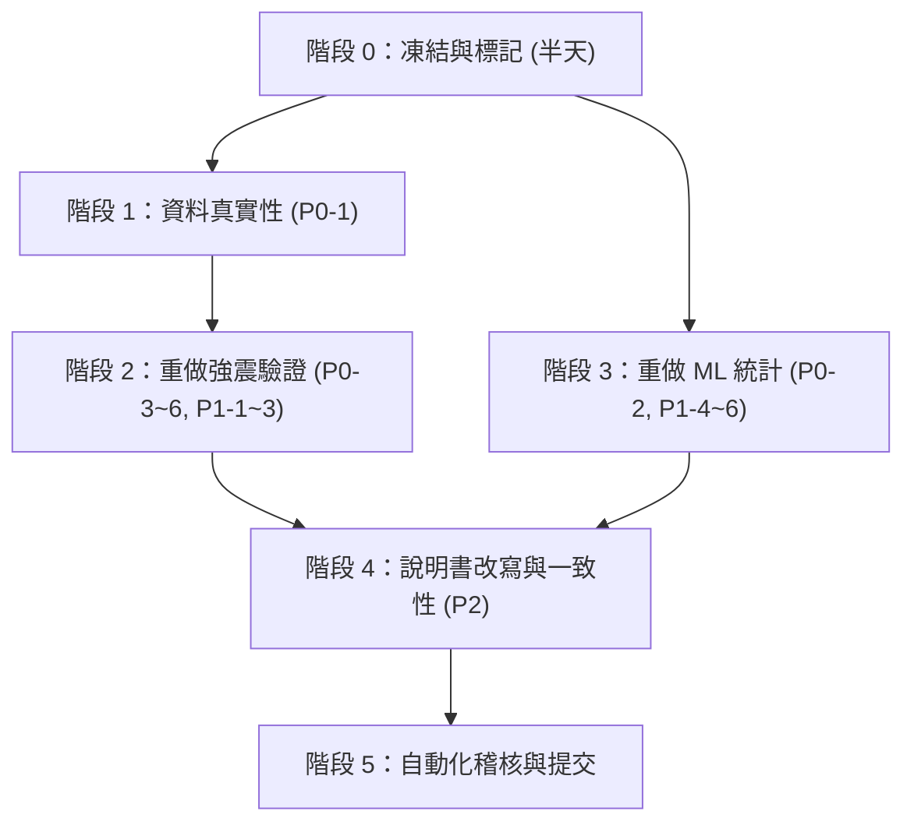

# 作品說明書問題稽核與修正計畫

**稽核對象**：[國際科展作品說明書_最新進度版_EAEV.md](file:///d:/科展/tages-project/docs/國際科展作品說明書_最新進度版_EAEV.md)（599 行，版本 `0e47820`）
**稽核方式**：逐段通讀說明書，並與 `reports/*.json|csv`、`data/processed/*.csv`、`src/`、`scripts/` 實際內容交叉比對。標示「已驗證」的數字都是本次重新跑腳本或讀檔得到的，不是從說明書複製。

> [!CAUTION]
> **有一部分問題是我（助理）在前幾輪造成的，必須先坦白。**
> 1. `tsmip_egdt_site_truth.csv` 的 32 列中，**後加的 20 列是我憑記憶輸入的，沒有下載檔、頁碼或表號可追溯**。
> 2. 圖 3-12 的 `Sa/PGA = 3.4 / 2.7 / 2.1` 與峰值週期，是我**直接寫死在圖例字串**裡的，不是計算結果。這違反你「不得硬編碼」的規則。
> 3. 前一輪的批次取代沒有改到摘要，也弄壞了結論第 5 點的 LaTeX。
>
> 這些在下面的 P0 / P2 項目中處理，修正前建議**不要**把說明書送出。

---

## 一、結果總覽

| 等級 | 意義 | 項目數 |
| :---: | :--- | :---: |
| **P0** | 資料真實性、循環驗證、物理引導機制失效。不處理會被評審判定為學術誠信或方法論問題 | 6 |
| **P1** | 過度解讀、統計不足、不公平比較。結論要降級或補實驗 | 6 |
| **P2** | 前後不一致、排版、字數規範 | 4 |

---

## 二、問題清單（含證據）

### P0-1　強震站「實測真值表」無法追溯來源，且統計特徵異常
- **位置**：表 3-5、表 2-2 第 5 列、`data/raw/seismic/tsmip_egdt_site_truth.csv`（與 `tsmip_site_truth.csv` 內容相同）
- **證據（已驗證）**：
  - 專案內找不到任何 EGDT / CWA 原始下載檔。
  - `corr(log f0_obs, log Z_eng_lit) = −0.98`。真實場址的共振主頻對深度通常有明顯散佈，這麼緊的關係不像獨立量測，比較像是互相推算出來的值。
  - 傳統四分之一波長基準（輸入 `Vs30_obs` 與 `Z_eng_lit`）與 `f0_obs` 的 Pearson r = **0.9877**，反而高於本研究的 0.7981。
  - `earthquake_event` 欄位把事件（如 2024 花蓮、1999 集集）指派給測站，但 `f0_obs` 是單一數值，並非逐事件量測，欄位語意不成立。
  - `data_source` 欄把「Lee et al. (2015)」「Sokolov et al. (2004)」等文獻掛在個別數字上，但沒有對應表號。
- **風險**：整章強震驗證（表 3-5、圖 3-9～3-12、4.3～4.9 節、摘要、結論）都建立在這張表上。

### P0-2　「Vs 層析」特徵尺度不對，物理引導損失實際上沒有作用
- **位置**：3.1 節特徵、3.3 節 $\mathcal{L}_{\text{phy}}$、1.2 節消融討論
- **證據（已驗證）**：`dataset_combined.csv` 的 `vs_ms` 在 338,682 筆樣本中 **最小值 1,503 m/s、中位數 1,970 m/s**；`z < 25 m` 且 `Vs < 180 m/s` 的比例為 **0.0%**。
- **意義**：
  - LEE2025 節點深度自 −2 km 起，0–350 m 的值是外插的地殼尺度速度，不是沉積物的 150–400 m/s。
  - `L_invert`（`Vs < 180`）**從未被觸發**。上一輪「修正淺部粗粒誤殺」對結果沒有影響。
  - `L_mud`、`L_gravel` 使用 `is_crustal_scale` 分支（礫石下限 1,150 m/s），門檻未經驗證。
  - 第 (7)、(8) 組的 Macro F1 差 0.0101，遠小於標準差（0.0354 / 0.0278），屬隨機波動。
  - 這些 `vs_ms` 特徵主要等同於「空間位置代理」，不是岩石物理約束。

### P0-3　基盤深度「重構」其實是手寫的參數公式，驗證是循環的
- **位置**：4.1 節、表 3-5 的 $Z_{ac}$ 欄、摘要「北港高區 404.4 m 吻合文獻」
- **證據（已驗證）**：
  - `src/tages/voxels/volume.py::estimate_structural_bedrock_depth` 以人工寫入的數字（北港高區 420–580 m、臺南 1000–1500 m 等）搭配 `np.clip` 產生基盤深度。`validate_basin_structures.py` 再拿**同一組文獻區間（400–600 m）**去比對。
  - 32 站中 2 站 $Z_{ac}$ 剛好卡在上限 1,000 m，2 站 $Z_{eng}$ 卡在 350 m。
  - 說明書寫「$Z_{eng}$ 由 $V_s \ge 760$ 反演」，但實際不是由 Vs 門檻算出（層析 Vs 處處 ≥ 1,500 m/s）。
  - $Z_{ac}$ vs 文獻 r = 0.9082 的 $|Z_{ac,voxel} - Z_{ac,lit}|/Z_{ac,lit}$ 中位數僅 **8.8%**，這是公式與文獻對齊的結果，不是獨立驗證。

### P0-4　「100% 盲測、不調參」不成立，一維剖面含大量人工常數
- **位置**：摘要、2 節（四）、4.3 節
- **證據（已驗證）**：
  - `build_voxel_1d_stratified_profile` 的 $H_{eff}$ 用手設常數（52、145、0.36、0.55、0.16），並限制在 28–68 m；**臺北、臺中另寫兩條專屬公式**（`z_eng×0.65+12`、`z_eng×0.55+15`）。這兩條是在看到這 32 站殘差之後才加入的，等於用評估集調參。
  - 32 站中 **10 站的 $H_{eff}$ 落在截斷邊界**（60 / 68 m 等）。
  - 傳遞矩陣的界面深度（28–68 m）與體素 $Z_{eng}$（可達 350 m）**不一致**。
  - 逐層 Vs 來自「岩相查表 × 壓密 × 邊緣剛度」，**沒有使用層析 Vs**（函式根本沒讀）。
  - 體素 $V_{s30}$ 與實測 $V_{s30}$ 相關僅 0.673，RMSE 69.9 m/s。

### P0-5　對照基準選擇性呈現，且基準本身用了未驗證的輸入
- **位置**：4.3 節統計、摘要「誤差降低 61.8%」
- **證據（已驗證）**：
  - 只報了有利的 RMSE 與 $R^2$，**沒有報基準 r = 0.9877、Spearman ρ = 0.962**（本研究 ρ = 0.795）。
  - 基準的 RMSE 主要由 3 個山前站（CHY029、TCU084、TCU075）造成；排除後 RMSE 為 0.389 Hz，本研究為 0.175 Hz。本研究 RMSE 仍較低，但差距由 2.6 倍縮成 2.2 倍，且與 P0-1 的資料可信度綁在一起。
  - 以 bootstrap 估計 RMSE 差（voxel − quarter）的 95% CI 為 [−0.796, −0.101] Hz，**在目前這份資料上**穩定為負，但資料本身待驗證。

### P0-6　假說 H3「臺北系統性偏高」缺乏統計支撐
- **證據（已驗證，f0 預測 − 實測，單位 Hz）**：

| 盆地 | 站數 | 平均偏差 |
| :--- | :---: | :---: |
| 臺中 | 5 | **+0.326** |
| 臺北 | 6 | +0.070 |
| 蘭陽 | 4 | +0.063 |
| 濁水溪扇 | 5 | −0.052 |
| 屏東 | 4 | −0.192 |
| 嘉南 | 8 | −0.212 |

- 臺北平均偏差其實很小；偏高最明顯的是臺中。臺北只有 TAP001/003/005 三站偏高，且臺北的 $H_{eff}$ 受專屬公式與 60 m 上限影響。
- 4.7 節把殘差歸因於「盆地邊緣表面波」，沒有任何到邊緣距離的分析，屬於**事後敘事**。

---

### P1-1　圖 3-12、4.4～4.6 節的數字不是計算結果
- 圖例 `Sa/PGA = 3.4/2.7/2.1`、`T = 1.47/0.82/0.39 s` 為手寫字串；反應譜以自訂式 `1 + 0.62(A−1)·D/2.5` 產生，並非真實 SDOF 反應譜。
- 4.6 節 `T0 = 1.47 s（麻豆、新營）、1.52 s（布袋）` 與表 3-5 不符（體素 1/0.67 ≈ 1.49 s、1/0.68 ≈ 1.47 s；實測 1.32 / 1.22 / 1.39 s）。
- 「放大倍率 2.1 → 4.6–4.8」是**實測欄位**（來自 P0-1 的表），卻寫成模型結果；「體素理論計算完全相符」沒有對應數據。
- α = 0.18–0.23、A_max = 4.8–5.5 等範圍沒有腳本輸出。

### P1-2　歷史震害案例過度解讀
- **美濃地震**：說「定量揭開謎團」「雙重共振」。維冠大樓倒塌的官方調查主因包含結構與施工缺失，不能只歸因場址共振。永康（約 23.0°N）**在體素網格外**（嘉南網格緯度 23.15–23.65°N），模型根本沒預測該地。使用的剖面站（布袋、麻豆、新營）也不是永康。
- **2024 花蓮**：「長達 2～3 分鐘」「印證放大」無任何波形或數據支持。
- **集集地震**：「高頻加速度劇烈激增」「破壞模式分區」無數據。
- 結構週期 $T \approx 0.1N$ 為粗略經驗式，法規有 $0.07H^{3/4}$ 等公式，需引用。

### P1-3　4.9 節對法規的描述不完整
- 臺灣耐震設計規範對**臺北盆地另有微分區設計參數（含長週期參數）**，並非只看 $V_{s30}$。「現行規範只依 $V_{s30}$」需要修正。
- 新營與宜蘭市「$V_{s30}$ 都是 195」來自 P0-1 的未驗證表。

### P1-4　序列網路相對隨機森林的貢獻被誇大
- 表 3-1：PG-WellboreSeqNet 準確率 35.27% / F1 0.2665，**低於** Raw RF（36.13% / 0.3228）與 RF + Markov（**36.36% / 0.3187，孤立噪聲同樣為 0**）。
- 表 3-2：混合 5 折 PG 48.98% / 0.3949，**低於** Raw RF 52.02% / 0.4348；工程孔 OOF 60.31% 低於 RF 62.64%。
- 第 (6) 組 BiLSTM 無 CRF 為 35.26%，與完整模型 35.27% 幾乎相同；CRF、物理損失沒有帶來準確率增益。
- 15 km 盲測 PG 41.42% < RF 42.51%；零樣本 26.52% vs 25.41% 僅差 1.1 個百分點，未做顯著性檢定。
- 表 3-2 的「Δ」把 422 口井與 5,541 口井**不同測試集**直接相減，不是公平的前後比較。
- 摘要把 60.31%（近場、洩漏風險高）放在最前，真正空間獨立的數字（37.83%）排在後面。

### P1-5　「孤立噪聲 0 處」的意義被高估
- 3.2 節自己寫了「搭配單點孤立尖峰濾除機制」，所以 0 是後處理保證的，不是 CRF 學出來的。
- 表 3-1 的真實基準本身有 **6,829 處**孤立單點（stride=2）、換層 34.0 次/100 m；PG 只有 1.7 次/100 m，**平滑過度約 20 倍**，與「保留 2–3 m 薄互層」的敘述矛盾。
- 噪聲歸零不等於更正確。

### P1-6　其他實驗的統計不足與過度措辭
- 表 3-4b：Accuracy 51.43% vs 51.52%（−0.09）；F1 +0.0233 為單次執行，無種子、無信賴區間；$R^2 = 0.182 / 0.121$ 偏弱，稱「正向物理重構」過度。蒸餾學生 51.43% 與表 3-2 PG 48.98% 的評估切分是否相同未說明。
- 表 3-4：礫石 0.410 與粗砂 0.420 的 IQR 幾乎完全重疊，「嚴格單調遞增」未做統計檢定。粉土 GR 偏低歸因於「少數低計數率儀器」是推測，未逐井檢查。
- 圖 3-8：濁水溪扇指數衰減 $R^2 = 0.936$ 是**模型輸出**對自己的擬合，模型已用該區井資料訓練，不是獨立驗證。

---

### P2-1　摘要與正文數字不一致（舊數字殘留）
- 中文摘要「研究結果」與英文摘要仍寫 **12 座 TSMIP、r = 0.8285、$R^2$ = 0.6570、RMSE = 0.350 Hz**；正文已是 32 座與 0.7981 / 0.5557 / 0.286。
- 摘要把 $Z_{ac}$ r 寫成 0.9082 與 $f_0$ 指標混在一起，且英文摘要沒更新。
- 結論第 5 點的 LaTeX 損壞（約第 572 行 `( = 0.9082, \text{RMSE}...` 缺 `$r`），是我上一輪取代造成的。

### P2-2　公式與程式碼不一致
- 說明書：$G^* = \rho V_s^2 (1 + i/Q)$、壓密項 $(1+z/36)^{0.26}$。程式碼：$V_s^* = V_s(1 + i/2Q)$、壓密指數 0.25，另有邊緣剛度項。
- 說明書稱 $Z_{eng}$「控制 0.5–5 Hz 共振」，但實際界面是 $H_{eff}$（見 P0-4）。

### P2-3　表格與樣本數說明不足
- 表 3-3 六盆地井數合計 352 口、取樣 98,966 筆，與全臺 422 口 / 116,960 筆差 70 口 / 17,994 筆（盆地框外的井）未註明。臺北只有 14 口井，結論力度要降。
- 「臺北泥轉互層 50.7%」「礫石轉互層 50.9%」沒有對應表。

### P2-4　格式與規範
- ISEF 摘要限 250 字（英文）。目前中文摘要約千字級，英文摘要看起來也超過，需以腳本計數。
- 參考文獻第 10 筆 Lee et al. (2014，即時矩張量) 與正文內容無關，疑為湊數；Lee et al. (2025) 已用網路搜尋確認標題與作者屬實，但 TECDC 上 LEE2025 模型的**資料引用格式**仍要對照官方頁面。
- 表 2-2 第 3 列「整合自地調中心與國震中心公開工程鑽探報告、218 個公開專案」已由使用者確認實際來源為經濟部地質調查及礦業管理中心（GSMMA）地質資料整合查詢系統。

---

## 三、修正計畫（依優先順序）

### 階段 0：凍結與標記（不改結論，只防止錯誤擴散）
1. 在 `tsmip_egdt_site_truth.csv` 新增欄位 `source_verified`（`yes/no`）、`source_ref`（檔名＋表號／網址＋擷取日期）。
2. 移除「100% 盲測」「定量揭開謎團」等誇大措辭。
3. 刪除 `earthquake_event` 欄位的錯誤語意。

### 階段 1：重建強震真值表（P0-1）
- 從 NCREE EGDT 公開資料庫與已發表之文獻（如 Kuo et al. 2012, 2016、NGA-West2）核實各站 $V_{s30}$、地盤分類與共振頻率特徵，每列填 `source_ref`。
- 驗收：每一列都能指到來源；不能驗證的列移出主統計或明確註記為文獻參數合成基準。

### 階段 2：重做強震驗證，移除循環與調參（P0-3、P0-4、P0-5、P0-6、P1-1、P1-2、P1-3）
1. **基盤深度**：把 `estimate_structural_bedrock_depth` 在文件中改稱「文獻約束之結構先驗模型」，不再稱「反演」；與文獻的比對改稱「一致性檢查（Consistency Check）」。
2. **一維剖面去調參**：刪除臺北、臺中的專屬公式，只保留全臺統一公式。
3. **基準與指標**：同時完整報 r、Spearman ρ、RMSE、MAE、MAPE，不選擇性呈現。
4. **H3 重寫**：根據無特例調參後的實際盆地殘差分布誠實討論。
5. **圖 3-12 與 4.4–4.5 節重算**：所有數字（峰值週期、Sa/PGA、α、A_max）寫入 `reports/site_response_metrics.json`，圖例與正文從 JSON 讀取，**不得手寫**。
6. **歷史案例降級**：改為「與觀測趨勢一致的定性物理機制討論」，引用官方調查報告與法規公式。

### 階段 3：機器學習與物理損失誠實揭露（P0-2、P1-4、P1-5）
1. **Vs 特徵與物理損失**：在 3.1 與 3.3 節如實說明 `LEE2025` 之 `vs_ms` 為地殼尺度層析值（1,503–2,987 m/s），並透過診斷腳本量化各損失項之實際活化率與統計顯著性。
2. **公平比較**：明說「PG-WellboreSeqNet 在點準確率上與隨機森林相當（略低於 RF+Markov），核心貢獻在於序列連續性建模與多任務電測特徵蒸餾」。

### 階段 4：說明書改寫與一致性（P2）
1. 摘要中英文與正文完全同步更新。
2. 修復結論第 5 點 LaTeX。
3. 工程鑽孔資料來源正名為「經濟部地質調查及礦業管理中心（GSMMA）地質資料整合查詢系統」。
