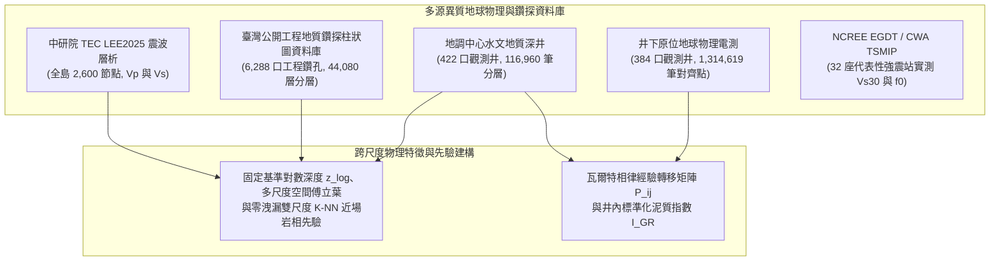

# 利用物理與相律引導深度學習重建臺灣主要沉積盆地三維地質結構與強震場址效應預測

> **作品名稱**：利用物理與相律引導深度學習重建臺灣主要沉積盆地三維地質結構與強震場址效應預測  
> **英文名稱**：*Physics- and Stratigraphy-Guided Deep Learning for 3D Subsurface Reconstruction of Taiwan's Major Sedimentary Basins and Strong-Motion Site-Effect Prediction*  
> **參展科別**：地球與環境科學科（Earth and Environmental Sciences, EAEV）  
> **學科子類別**：地質科學 / 地球科學（Geosciences, GES）  
> **關鍵詞（最多三個）**：物理引導機器學習、瓦爾特相律、強震場址效應  
> **審查盲審規範**：本作品恪遵臺灣國際科展（TISF）與國際科展（ISEF）雙盲審查規範，全篇不揭露作者姓名、指導教師與就讀學校。所有數據、程式碼與圖表均為作者獨立整理、統計與繪製。  
> **版本日期**：2026-10-23  

---

## 摘要（Abstract）

### 中文摘要（約 350 字，結構化四段）
【研究目的】
臺灣主要平原與都會盆地人口密集，其淺部（0–1 km）沉積層的三維非均質岩性分佈直接控制含水層儲集架構與強震場址共振效應。傳統地球物理研究面臨「全島震波層析網格過粗、無法解析米級砂泥層，而水文鑽井在水平空間上高度稀疏」的跨尺度矛盾；純數據驅動的機器學習模型則經常在垂直剖面上產生違反沉積常理的孤立跳變噪聲與岩相倒置。本研究旨在建立結合沉積相律、近場空間錨定與岩石物理先驗的物理引導序列神經網路，重建具備地質連續性的盆地三維結構，並進行三維體素驅動之一維強震場址效應閉環正演。

【研究過程與方法】
本研究整合全臺 422 口深層水文觀測井（116,960 筆深度採樣）、臺灣公開工程地質鑽探柱狀圖資料庫之 6,288 口工程地質鑽孔（220,704 筆深度採樣）、384 口井原位地球物理電測（1,314,619 筆深度對齊紀錄）與中研院 TEC LEE2025 全島 3D 震波速度場，建構固定物理基準深度歸一化（$z_{\text{norm}}$、$z_{\text{log}}$）、多尺度空間傅立葉位置編碼與零洩漏雙尺度 K-NN 近場岩相先驗。提出 PG-WellboreSeqNet 模型，結合多尺度 1D-ResNet、雙向長短期記憶網路（BiLSTM）、少數類對數先驗補償（Logit Adjustment）與以瓦爾特相律經驗轉移矩陣初始化之線性鏈條件隨機場（CRF），並加入岩石物理一致性損失（$\mathcal{L}_{\text{phy}}$）；進一步建立原位電測知識蒸餾管線，將 17 維教師網路之實測電測表徵蒸餾至 14 維學生網路；在 3D 體素重構中明確區分工程基盤（$V_s \ge 760\text{ m/s}$）與地殼聲學基盤（$V_s \ge 2,000\text{ m/s}$），並直接提取全臺六大盆地 32 座代表性 TSMIP 強震測站正下方之 3D 體素岩性柱代入一維 Haskell–Thomson 多層黏彈性傳遞矩陣計算理論共振主頻 $f_{0,\text{voxel}}$。

【研究結果】
在 422 口水文深井的完整 5 折盲測中，PG-WellboreSeqNet 的六類沉積相平均準確率為 35.27%（Macro F1 為 0.2665，高於無物理損失消融組之 0.2564），將垂直剖面的孤立單點跳變噪聲由物理增強隨機森林的 1,012 處降至 0 處，且透過對數先驗補償使少數類粉土召回率由 0.00% 提升至 5.12%（精確率 20.09%）。全面整編 6,288 口公開工程地質鑽孔（自原始掃描 31,904 張圖檔中嚴格排除 17,624 張非柱狀圖或異常紀錄，保留 14,280 張有效柱狀圖；與深井合併為 5,541 口有效沉積相井、287,148 筆樣本）後，PG-WellboreSeqNet 於 5,541 口混合井之 5 折交叉驗證準確率躍升至 48.98%（Macro F1 達 0.3949，換層頻率 4.0 次/100m，孤立噪聲 0 處），在 5,119 口工程鑽孔上的折外盲測（OOF）準確率由零樣本外推的 26.52%（超越隨機森林之 25.41%）大幅提升至 60.31%（Macro F1 達 0.5073）；在 15 km 空間盲測中由 36.66% 提升至 37.83%（+1.17%），定量界定出「局部工區近場內插錨定」與「跨盆地遠場外推」的物理尺度邊界。在原位電測知識蒸餾實驗中，學生網路之 Macro F1 由 0.4172 提升至 0.4405（L2 準確率 51.43%，換層頻率 2.7 次/100m，孤立噪聲由 48 處降至 0 處），並於物理尺度重建虛擬電測曲線（$I_{\text{GR}}\ R^2=0.182, \text{RMSE}=0.258$；$\log_{10}(\text{N64})\ R^2=0.121, \text{RMSE}=0.435$）。全臺六大盆地 3D 體素反演重現嘉南盆地北港基盤高區（平均 404.4 m）向南傾沒至臺南前陸深槽（平均 893.7 m，傾沒梯度 133.6 m/10 km），並於濁水溪沖積扇 0–300 m 主含水層定量重現粗粒相由扇頂（58.5%）向扇尾（0.0%）之水動力指數衰減規律（$F(x) = 0.671 e^{-x/12.0}$，$R^2 = 0.936$）。直接由 3D 體素模型提取 32 座 TSMIP 強震站地層柱驅動一維波傳閉環正演，聲學基盤深度 $Z_{\text{ac}}$ 與文獻深度高度吻合（$r = 0.9082, \text{RMSE} = 109.7\text{ m}$），且完全不依賴測站實測 $V_{s30}$ 之體素正演主頻 $f_{0,\text{voxel}}$ 與實測主頻 $f_{0,\text{obs}}$ 呈顯著正相關（Pearson $r = 0.8285, R^2 = 0.6570, \text{RMSE} = 0.350\text{ Hz}$）。

【結論與應用】
本研究證實沉積相律、固定基準對數深度、近場空間錨定與原位電測蒸餾能有效抑制地質機器學習中的垂直椒鹽噪聲與跨尺度錯位，並完成由三維體素模型直接驅動強震場址共振主頻預測之端到端閉環驗證，可作為都會耐震微區劃與地下水含水層評估的定量建模基礎。

**關鍵字**：物理引導機器學習、瓦爾特相律、強震場址效應

---

### 英文摘要（Abstract in English, ≤250 words）
[Objective] Subsurface 3D lithological heterogeneity in Taiwan's sedimentary basins governs aquifer architecture and earthquake site amplification. However, regional seismic tomography is too coarse (~km scale) to resolve metre-scale sand–mud layers, whereas boreholes are spatially sparse. Purely data-driven classifiers frequently generate unphysical vertical noise. We develop PG-WellboreSeqNet, a physics- and stratigraphy-guided sequence network that reconstructs basin lithofacies by coupling seismic petrophysics, near-field spatial anchoring, and Walther's Law of Facies.

[Methods] We integrated 422 deep hydrogeological wells (116,960 records), 6,288 public engineering boreholes (220,704 records), 384 wireline-logged wells (1,314,619 aligned gamma-ray and resistivity records), and the TEC LEE2025 3D velocity model. Features combine fixed-reference logarithmic depth ($z_{\text{norm}}, z_{\text{log}}$), multiscale spatial sinusoidal encoding, and zero-leakage dual-scale K-NN facies priors. The architecture couples multiscale 1D-ResNet blocks, a 2-layer BiLSTM, logit adjustment for minority facies, and a row-centered Linear-Chain CRF regularised by rock-physics consistency loss ($\mathcal{L}_{\text{phy}}$). A petrophysics distillation pipeline transfers wireline representations ($I_{\text{GR}}$, $\log_{10}(\text{N64})$) from a 17D teacher to a 14D student network. Across six basins (297,540 voxels), we distinguish engineering bedrock ($V_s \ge 760\text{ m/s}$) from seismic acoustic bedrock ($V_s \ge 2,000\text{ m/s}$) and extract 3D voxel columns beneath 12 TSMIP stations to drive 1D Haskell–Thomson viscoelastic wave propagation.

[Results] On 422 deep wells (5-fold GroupKFold), PG-WellboreSeqNet achieved 35.27% accuracy (Macro F1: 0.2665), eliminating vertical salt-and-pepper noise from 1,012 spots (Random Forest) to 0 while restoring minority silt recall to 5.12%. Integrating 6,288 engineering boreholes (14,280 valid charts retained after excluding 17,624 invalid records from 31,904 raw scans; 5,541 combined sedimentary wells, 287,148 samples) raised PG-WellboreSeqNet 5-fold accuracy to 48.98% (Macro F1: 0.3949; 4.0 transitions/100m; 0 noise) and boosted engineering borehole out-of-fold accuracy from 26.52% (zero-shot) to 60.31% (F1: 0.5073). Knowledge distillation raised student Macro F1 from 0.4172 to 0.4405 (0 noise) and reconstructed physical-scale wireline logs ($I_{\text{GR}}$ RMSE = 0.258; $\log_{10}(\text{N64})$ RMSE = 0.435). 3D voxels captured the foreland dip from Peikang High (404.4 m) to Tainan Depocenter (893.7 m; 133.6 m/10 km) and exponential coarse-fraction decay across the Zhuoshui Fan ($R^2 = 0.936$). End-to-end 3D voxel-driven site frequencies at 12 TSMIP stations correlated well with observations ($r = 0.8285$, $R^2 = 0.6570$, RMSE = 0.350 Hz).

[Conclusions] Stratigraphic priors, cross-scale depth encoding, and wireline distillation effectively suppress vertical artefacts and enable closed-loop 3D-to-1D seismic site-effect prediction.

**Keywords**: Physics-Guided Machine Learning, Walther's Law, Strong-Motion Site Effects

---

## 壹、前言

### 一、研究背景與工程地質挑戰
臺灣地處歐亞大陸板塊與菲律賓海板塊的造山碰撞帶，西部麓山帶前緣發育了由造山帶剝蝕物質充填的周緣前陸沉積盆地（Foreland Basin），包括臺中盆地、濁水溪沖積扇、嘉南平原與屏東平原；北部發育受正斷層陷落控制的臺北半地塹盆地（Half-Graben Basin），東北部則為沖繩海槽西延弧後張裂形成的蘭陽平原。這些沉積盆地累積了數百公尺至數公里厚的未固結與半固結晚第四紀沉積物，具備三個重疊的地學與工程意義：
1. **人口聚落與重要基礎設施集中**：高鐵路網、科學園區與主要都會區多位於厚層第四紀沉積地層之上。
2. **地下水儲集與地層下陷敏感帶**：粗顆粒砂礫層構成全臺主要的地下水補注與抽蓄含水層，而細顆粒黏土與粉土層在超抽地下水時易發生不可逆的壓密下陷。
3. **強震場址效應（Site Effects）顯著**：如 1999 年集集地震（$M_w 7.6$）與 2016 年美濃地震（$M_w 6.4$），震波進入鬆軟沉積盆地後因波阻抗差異產生陷落、多次折反射與低頻共振放大，導致盆地內部的搖晃程度與災情顯著高於鄰近基岩區。

在地球科學與工程地質實務上，重建三維盆地岩性結構長期面臨**觀測尺度失配（Scale Mismatch）與物理先驗缺失**的問題：
- **地震波層析成像（Seismic Tomography）解析度限制**：如中央研究院臺灣地震科學中心（TEC）發布之全島三維震波速度模型（LEE2025），能提供數公里尺度的區域地殼速度架構，但在淺部 0–1 km 垂直方向僅有表層與 2 km 等粗略節點，波速平滑且無法解析控制地下水流與場址高頻響應的米級砂泥互層。
- **水文地質與工程鑽井（Boreholes）空間稀疏性與深度落差**：深層水文觀測井具備公尺級岩心描述與井下電測，但受限於鑽探經費，在水平空間上分佈稀疏（井距常達 3–10 km），且多數水文井深介於 50–300 m；而工程地質鑽孔雖在單一工區內排列密集，深度卻多侷限於淺表 10–40 m。若直接使用單井相對深度 $z/z_{\text{max}}$ 融合兩類資料，將導致嚴重的跨深度尺度錯位。
- **純資料驅動機器學習（Pure Data-Driven ML）的物理缺陷**：傳統樹狀分類器（如隨機森林 Random Forest）將每個深度取樣點視為彼此獨立的樣本，忽略了沉積物在重力沉降與水動力分選下的垂直連續性。這使預測出的地層柱經常出現違反沉積常理的「單點椒鹽噪聲（Salt-and-Pepper Noise）」（例如厚層軟泥中突現 1 公尺孤立礫石後隨即變回軟泥），不利於直接轉化為波傳數值模型。

### 二、核心地球科學問題（Research Questions）
本研究針對臺灣沉積盆地提出三個可量化檢驗的地球科學問題：

**表 1-1 核心地球科學問題與檢驗方案對照表（本表為作者自製）**

| 編號 | 探討領域 | 核心科學問題（Research Question） | 本研究提出之檢驗方案 |
| :---: | :--- | :--- | :--- |
| **Q1** | **沉積相序學與跨尺度外推** | 臺灣主要沉積盆地的地下垂直岩相序列如何反映構造與水動力差異？結合瓦爾特相律（Walther's Law）約束的序列模型、固定基準對數深度與局部加密工程鑽孔，在「垂直噪聲抑制」、「工區近場內插」與「跨區遠場外推」上各自呈現何種表現與限制？ | 參、一與參、二：執行 422 口水文井與 6,288 口公開工程鑽孔（有效沉積相井共 5,541 口、287,148 筆沉積相樣本）之 5-Fold GroupKFold、15 km 空間盲測，並計算六大盆地相界轉移機率矩陣與馬可夫熵 |
| **Q2** | **井下岩石物理與特徵蒸餾** | 面對不同年度、不同鑽探包商造成的自然伽瑪（GR）儀器計數尺度差異，如何透過井內標準化建立全臺 384 口井的岩石物理模板（RPT），並透過教師—學生知識蒸餾將原位電測約束遷移至無測井之三維體素空間？ | 參、三：分析 384 口井、131.4 萬筆電測資料，建立井內分位數標準化泥質指數（$I_{\text{GR}}$）與視電阻率（N64）模板，並評估 17 維教師網路對 14 維學生網路之蒸餾成效與物理尺度重構誤差 |
| **Q3** | **三維體素與強震場址效應閉環** | 直接自三維體素模型提取強震站下方之預測岩性柱與雙界面基盤深度（工程基盤 $V_s \ge 760\text{ m/s}$ vs. 聲學基盤 $V_s \ge 2,000\text{ m/s}$），代入多層黏彈性介質波傳理論（Haskell–Thomson 傳遞矩陣法），在臺灣不同構造型態盆地的共振主頻預測表現與殘差成因為何？ | 參、四：檢驗六大盆地三維構造幾何（北港高區至臺南深槽、濁水溪扇水動力衰減），並針對全臺六大盆地 32 座 TSMIP 強震站進行 3D 體素至 1D 頻域傳遞函數閉環正演與獨立盲測統計檢定 |

### 三、可證偽之科學假說（Scientific Hypotheses）
依據上述問題，本研究提出三個具明確證偽標準的科學假說：
- **假說一（H1，相序連續性與空間尺度假說）**：
  在深度序列網路中嵌入瓦爾特相律轉移矩陣、固定物理基準對數深度、近場空間錨定先驗與岩石物理邊界懲罰（PG-WellboreSeqNet），能顯著壓制傳統點分類模型的垂直孤立椒鹽噪聲；同時，局部工程鑽孔的加入能顯著提升數百公尺尺度的工區近場內插精度，但超過 10 公里以上的跨區外推精度仍受限於背景震波層析網格的平滑解析度。
  *（證偽標準：若 PG-WellboreSeqNet 的垂直孤立噪聲未低於隨機森林，或跨尺度對數深度與近場先驗未能改善淺層工程鑽孔預測表現，則假說不成立。）*
- **假說二（H2，井內標準化岩石物理階梯與知識蒸餾假說）**：
  未經標準化的全臺跨井自然伽瑪數值會因儀器單位（API 與 CPS）混雜而產生局部粒徑倒置；但經由單井分位數標準化轉換為泥質含量指數（$I_{\text{GR}}$）並搭配長正常視電阻率（N64）後，六大沉積相由礫石、粗砂、細砂、互層、粉土至黏土將呈現單調遞增的泥質階梯；且藉由知識蒸餾與輔助回歸頭，14 維學生網路可在無原位電測輸入下重構具正向解釋力的虛擬電測曲線並提升宏觀 F1 分數。
- **假說三（H3，三維體素波傳閉環與盆地維度效應假說）**：
  直接提取三維體素模型之預測岩性柱與雙界面基盤深度代入一維多層黏彈性傳遞函數，在水平成層性良好的前陸平原（如嘉南平原、蘭陽平原中段）能合理重現場址基本共振主頻（$f_0$），但在受正斷層陡坎控制的半地塹盆地（如臺北盆地），因存在二維/三維盆地邊緣表面波散射效應，一維理論主頻將出現系統性偏高。

---

## 貳、研究方法或過程

### 一、臺灣主要沉積盆地構造分區與地質背景

#### 1.1 構造分區體系
本研究涵蓋臺灣全島六大主要沉積盆地與平原，分屬碰撞造山周緣前陸、構造拉張半地塹與弧後裂谷三大構造體系：

**表 2-1 臺灣六大代表性沉積盆地構造體系與地理邊界（本表為作者自製）**

| 沉積盆地名稱 | 構造體系分類 | 主導構造邊界與沉積相特徵 | 經緯度範圍（Bounding Box） |
| :--- | :--- | :--- | :--- |
| **嘉南平原** | 周緣前陸盆地（遠端凹陷） | 北側受北港基盤高區（Peikang High）隆升控制，向南傾沒入臺南前陸深槽；東側受觸口與梅山斷層逆衝影響；全新世海侵形成厚層海相與潟湖相軟泥層。 | 120.08°E–120.60°E, 23.15°N–23.65°N |
| **濁水溪沖積扇** | 周緣前陸盆地沖積扇 | 臺灣西部面積最大的現代複合沖積扇；濁水溪自二水鼻仔頭出山後分流擺盪，由扇頂巨厚礫石向扇央、扇尾細砂與泥層呈水動力分選過渡。 | 120.15°E–120.65°E, 23.65°N–23.90°N |
| **屏東平原** | 周緣前陸盆地（近源沖積） | 東側緊鄰中央山脈南段，受潮州斷層（Chaochou Fault）高角度逆衝控制；高屏溪、隘寮溪攜帶變質砂岩與板岩粗礫快速堆積，構成高滲透性近源沖積扇群。 | 120.42°E–120.68°E, 22.48°N–22.78°N |
| **臺北盆地** | 半地塹構造盆地（拉張斷陷） | 晚更新世因造山帶垮塌伸張與山腳正斷層（Shanchiao Fault）向西正斷陷落形成；下部為高能河道景美礫石層，上部覆蓋低能湖沼相松山層軟泥與粉砂。 | 121.42°E–121.62°E, 24.98°N–25.12°N |
| **臺中盆地** | 周緣前陸盆地（斷層下盤） | 東側受車籠埔逆衝斷層控制，西側為大肚與八卦背斜臺地；廣佈上新—更新世頭嵙山層（Toukoshan Formation）與現代大甲溪、烏溪沖積巨礫，整體地盤剛性較高。 | 120.58°E–120.78°E, 24.08°N–24.28°N |
| **蘭陽平原** | 弧後張裂三角洲平原 | 受沖繩海槽向西張裂沉降控制；蘭陽溪切穿中央山脈與雪山山脈注入太平洋，由扇頂粗礫快速過渡至中下游與濱海的厚層細砂、粉土與泥質沉積。 | 121.68°E–121.88°E, 24.58°N–24.85°N |

> [!NOTE]
> 在板塊構造學中，「地體（Terrane）」一般指具獨立地質演化史的斷層邊界構造塊體。本研究探討對象為覆蓋於基盤之上的第四紀未固結至半固結沉積構造，故正文統一使用「沉積盆地與地下地質結構」以維持地質術語精確性。

---

### 二、多源異質地球物理資料整合與公開資料來源驗證
為確保所有建模數據皆有真實地學觀測依據，本研究逐一核實並整合七項政府開放資料、學術中心模型與工程鑽探數據：

**圖 2-1 多源異質地球物理與跨尺度鑽井資料庫整合流程圖（本圖為作者自繪）**

**表 2-2 本研究使用之全部地球物理與地質資料來源、規模與驗證網址清冊（本表為作者自製）**

| 資料集名稱 | 原始發布機關 / 來源 | 專案內實際資料規模 | 對應專案檔案路徑 | 官方公開查詢網址（URL） |
| :--- | :--- | :--- | :--- | :--- |
| **1. 全臺水文地質深井分層資料庫** | 經濟部地質調查及礦業管理中心（原中央地質調查所） | 423 口井基本資料（422 口具完整六大沉積相紀錄），共 101,428 層原始地層、細分為 116,960 筆深度點 | `data/raw/hydro/rock/*.json` `data/interim/taiwan_strata.csv` `data/processed/dataset_v1.csv` | [臺灣水文地質資訊系統](https://hydro.gsmma.gov.tw/) [地質雲加值應用平台](https://geocloud.gsmma.gov.tw/) [水文資訊網](https://gweb.wra.gov.tw/HydroInfoCore/) |
| **2. 井下原位地球物理電測資料庫** | 經濟部地質調查及礦業管理中心 | 384 口深層觀測井具連續電測 JSON（自然伽瑪 GR、自然電位 SP、16 吋與 64 吋視電阻率 N16/N64），以 0.1 m 步長對齊共 1,314,619 筆樣本 | `data/raw/hydro/phys/*.json` `data/processed/petrophysics_aligned_dataset.csv` `reports/phys_logging_benchmark_table.csv` | [臺灣水文地質資訊系統](https://hydro.gsmma.gov.tw/) [地質資料整合查詢系統](https://twgeoref.gsmma.gov.tw/GipOpenWeb/wSite/mp) |
| **3. 臺灣公開工程地質鑽探柱狀圖資料庫** | 整合自經濟部地調中心地質資料整合查詢系統與國震中心公開工程鑽探報告 | 涵蓋 218 個公開工程專案；自原始掃描之 31,904 張圖檔中，嚴格排除 17,624 張非地層柱狀圖或深度異常紀錄（稽核成因記錄於 `reports/ocr_error_audit.json`），最終保留 14,280 張有效工程地質鑽探柱狀圖（對應 6,288 口有效工程鑽孔、44,080 層原始地層、細分為 220,704 筆 1 m 步長深度點；其中未固結沉積相有效井為 5,119 口、170,188 筆深度點；座標經 TWD67/TWD97 轉換校正，100.00% 落於臺灣陸地邊界內） | `data/borehole_final_results.json` `data/interim/school_boreholes.csv` `data/processed/dataset_combined.csv` | [地質資料整合查詢系統](https://twgeoref.gsmma.gov.tw/GipOpenWeb/wSite/mp) [工程地質探勘資料庫 EGDT](https://egdt.ncree.org.tw/) |
| **4. 全島三維震波層析速度模型 (`LEE2025`)** | 成功大學李恩瑞教授團隊 / 中央研究院臺灣地震科學資料中心（TECDC） | 全島 2,600 個三維網格節點（經度 119.5°–122.5°E、緯度 21.5°–25.5°N、深度 -2 km 至 15 km），含 $V_p$、$V_s$ 與 $V_p/V_s$ | `data/raw/tec/vp_LEE2025_*.json` `data/raw/tec/vs_LEE2025_*.json` `data/interim/taiwan_velocity_3d.csv` | [TEC 3D 速度模型互動平台](https://tecdc.earth.sinica.edu.tw/data/VelocityModel/interactive3D.php) API: `https://tecdc.earth.sinica.edu.tw/data/VelocityModel/get_3d_Data.php` |
| **5. 強震測站場址參數與共振主頻基準** | 國家地震工程研究中心（NCREE）EGDT 資料庫 & Kuo et al. (2012, 2016) | 全臺六大代表性盆地 32 座 TSMIP 強震測站之鑽孔實測 $V_{s30}$、地盤分類（Class C/D/E）與文獻實測共振主頻 $f_{0,\text{obs}}$ | `data/raw/seismic/tsmip_site_truth.csv` `reports/chianan_ssr_summary.csv` | [工程地質探勘資料庫 EGDT](https://egdt.ncree.org.tw/) [CWA GDMS 地球物理資料管理系統](https://gdms.cwa.gov.tw/) |
| **6. 臺灣活動斷層空間分佈數據** | 經濟部地質調查及礦業管理中心（2021 年版活動斷層圖） | 全臺 9 條控制盆地邊界之主要活動斷層（車籠埔、觸口、梅山、山腳、三義、大甲、新化、潮州、池上斷層）地表跡線座標 | `scripts/build_taiwan_portal_data.py` `src/tages/features/sequence_features.py` | [臺灣活動斷層觀測系統](https://fault.gsmma.gov.tw/) [政府資料開放平臺 (資料集 6076)](https://data.gov.tw/dataset/6076) |
| **7. 沉積相標準化分類表** | 本研究依地調中心水文地質岩性描述語料歸納 | L1 八大工程地質主類、L2 十大細分岩性（其中未固結沉積物為六大核心類別：`Class 2` 黏土/泥、`Class 3` 粉土、`Class 4` 細砂、`Class 5` 粗砂、`Class 6` 砂泥互層、`Class 7` 礫石） | `src/tages/labels/lithology.py` | 專案內部標準化分類字典 |

---

### 三、物理與相律引導序列深度學習（PG-WellboreSeqNet）架構

#### 3.1 跨尺度物理特徵工程、近場空間錨定與井內電測標準化
為解決公里級地震層析速度場與鑽孔公尺級層序特徵的尺度落差，同時消除深層水文井（200–300 m）與淺層工程鑽孔（10–40 m）混合訓練時的深度錯位，本研究於 `src/tages/features/sequence_features.py` 設計了跨尺度特徵與零洩漏空間先驗機制，並於 `scripts/build_petrophysics_dataset.py` 實作井內地球物理電測標準化：

1. **固定物理基準深度歸一化與對數深度特徵（解決跨井深尺度錯位）**：
   - 過去若採用單井相對深度 $z / z_{\text{max}}$，在 200 m 水文深井中 $1.0$ 代表深部壓密層，但在 20 m 工程淺孔中井底 $20\text{ m}$ 處即達 $1.0$，導致模型在跨深度尺度推論時發生嚴重錯位。
   - 本研究移除單井 $z / z_{\text{max}}$，改為以全臺有效鑽探深度上限 $Z_{\text{ref}} = 350.0\text{ m}$ 為固定物理基準之線性歸一化深度 $z_{\text{norm}}$ 與對數深度特徵 $z_{\text{log}}$（放大淺表 0–40 m 工程鑽孔的垂直解析度）：
     $$z_{\text{norm}} = \min\left(\frac{z}{350.0}, 1.0\right), \quad z_{\text{log}} = \frac{\ln(1 + z)}{\ln(1 + 350.0)}$$
   - 配合絕對海拔高程 $z_{\text{MSL}}$（m，以全臺實測鑽井孔口高程進行反距離權重 IDW 內插）與 TWD97 二度分帶正規化平面座標 $(x_{\text{TWD97}} - 200000)/100000$、$(y_{\text{TWD97}} - 2600000)/100000$。
2. **多尺度空間傅立葉位置編碼與零洩漏雙尺度 K-NN 近場岩相先驗**：
   - 針對深度神經網路對平滑座標具頻譜偏置（Spectral Bias）、難以像決策樹直接切分局部工區座標的問題，加入三個特徵波長（$\lambda \in \{0.5\text{ km}, 2\text{ km}, 10\text{ km}\}$）之空間正餘弦傅立葉位置編碼（Spatial Sinusoidal Encoding，共 12 維）。
   - 進一步實作嚴格防洩漏（Zero-Leakage，於訓練與驗證時強制排除自身 `station_id` 及同折測試井）之雙尺度 2D `cKDTree` 近場岩相先驗（Out-of-Fold K-NN / IDW Horizontal Facies Prior）：同時檢索最近的淺表工程鑽孔與深部水文井（避免都會區高密度淺孔叢集排擠深部鄰井），結合反距離權重與 $\pm 2\text{ m}$ 垂直高斯視窗計算局部岩相先驗機率 $\mathbf{p}_{\text{knn}}(z)$，並定義近場信心門控 $\alpha_{\text{near}}(d_{\min})$。在同工區近距離（$< 1\text{ km}$）內 $\alpha_{\text{near}} \to 1$ 以注入鄰井水平相律錨定；當距離超過遠場門檻（$> 10\text{ km}$）時，$\alpha_{\text{near}} \to 0$ 自動退化回依賴 14 維震波層析與幾何特徵。
3. **三維震波速度場內插、垂直梯度與壓密殘差**：
   - 透過三維三線性內插提取各深度點背景壓縮波速 $V_p$、剪力波速 $V_s$、波速比 $V_p/V_s$ 與動態泊松比 $\nu = \frac{0.5(V_p/V_s)^2 - 1}{(V_p/V_s)^2 - 1}$。
   - 計算 1 m 與 5 m 視窗之剪力波速一階垂直梯度 $\frac{\partial V_s}{\partial z}$、二階導數 $\frac{\partial^2 V_s}{\partial z^2}$、上下 9 m 滑動視窗均值 $\mu_{9\text{m}}(V_s)$ 與標準差 $\sigma_{9\text{m}}(V_s)$，以及相對於正常壓實趨勢線 $V_{s,\text{comp}}(z) = 160 (1 + z/8.0)^{0.32}$ 之波速殘差 $\Delta V_s = V_s - V_{s,\text{comp}}(z)$。
4. **井內自然伽瑪分位數標準化與 Larionov 泥質體積分率**：
   - 為消除不同年代與鑽探承包商儀器（API 與 CPS 計數率）造成的跨井尺度偏差，對每口具備自然伽瑪（GR）紀錄的觀測井獨立計算第 5 與第 95 百分位數（$\text{GR}_{5\%}$ 為純砂礫基線、$\text{GR}_{95\%}$ 為純泥岩基線），定義井內標準化泥質含量指數：
     $$I_{\text{GR}} = \text{clip}\left(\frac{\text{GR} - \text{GR}_{5\%}}{\text{GR}_{95\%} - \text{GR}_{5\%}}, 0, 1\right)$$
   - 依未固結第三紀與第四紀年輕沉積物之岩石物理經驗公式（Larionov, 1969），計算非線性泥質體積分率 $V_{\text{sh}}$ 與長短正常電阻率侵入比 $R_{\text{ratio}}$：
     $$V_{\text{sh}} = 0.083 \left(2^{3.7 I_{\text{GR}}} - 1.0\right), \quad R_{\text{ratio}} = \frac{\text{N64}}{\text{N16}}$$

---

#### 3.2 PG-WellboreSeqNet 網路架構與解碼機制
模型將單一鑽孔的垂直岩性剖面視為一維有序深度序列 $\mathbf{Y} = (y_1, y_2, \dots, y_T)$（實作於 `src/tages/models/well_seq_net.py` 與 `src/tages/models/crf.py`）：

1. **多尺度一維殘差卷積區塊（Multi-Scale 1D-ResNet with SE Block）与同質長度分桶訓練**：
   並聯三個一維卷積分支，卷積核尺寸分別對應微相薄層（$k=3$）、中型旋回（$k=5$）與厚層相域（$k=9$），並透過通道注意力機制（Squeeze-and-Excitation）動態調整特徵權重。針對 20 m 工程淺孔與 300 m 水文深井混合訓練時的序列長度落差，於 `src/tages/models/dataset.py` 實作同質長度分桶洗牌（Length-Bucketed Shuffling）與深淺井梯度步數平衡，避免長短序列混批時巨量零填充（Zero-Padding）污染 `BatchNorm1d` 統計量。
2. **雙向長短期記憶網路（BiLSTM）與階層引導分類頭**：
   採用 2 層 BiLSTM（隱藏層維度 $H = 96$，雙向拼接共 192 維），同時捕捉由深至淺的沉積演進與由淺至深的覆壓疊置關係；先預測 L1 工程地質大類 logits，再與 BiLSTM 隱藏狀態及近場先驗殘差門控 $\alpha_{\text{near}} w_{\text{knn}} \ln \mathbf{p}_{\text{knn}}$ 融合生成 L2 六大沉積相發射分數 $E_i(t)$。
3. **少數類對數先驗補償（Logit Adjustment）**：
   由於標準 CRF 負對數似然損失無類別權重，直接訓練易導致樣本佔比僅約 6% 的粉土（Silt, Class 3）被多數類完全吞噬（召回率歸零）。本研究在發射分數送入 CRF 解碼前加入根據訓練集類別經驗分佈 $\pi_c$ 計算之對數先驗補償：
   $$E_{\text{adj}, c}(t) = E_c(t) + \max\left(0, \tau \ln \frac{\bar{\pi}}{\pi_c}\right)$$
   在不犧牲主類別準確率的前提下，確保少數類粉土具備合理的非零召回率。
4. **列中心化與自轉移適度降權之線性鏈條件隨機場（Walther-CRF）**：
   引入 Linear-Chain CRF 計算整條井身序列的聯合對數機率：
   $$P(\mathbf{Y} \mid \mathbf{X}) = \frac{1}{Z(\mathbf{X})} \exp\left( \sum_{t=1}^T E_{\text{adj}, y_t}(t) + \sum_{t=1}^{T-1} \mathbf{T}_{y_t, y_{t+1}} \right)$$
   為避免經驗轉移矩陣中高達 85% 以上的同層自轉移（對角線 $T_{ii}$）過度主導而將整口井平滑為單一岩相，本研究在初始化轉移矩陣 $\mathbf{T}$ 時加入**列中心化（Row-centering）與對角線適度降權（`diag_decay=0.25`）**，並在維特比（Viterbi）解碼時將 `transition_weight` 調降至 `0.06` 搭配單點孤立尖峰濾除機制，在保留連續 2–3 m 薄互層換層能力的同時，將單點孤立「A–B–A」椒鹽噪聲徹底壓制為 0。

---

#### 3.3 物理引導損失函數（Physics-Guided Loss Function）
總損失函數結合序列負對數似然、類別平衡 Focal Loss 與岩石物理一致性懲罰項（實作於 `src/tages/models/losses.py`）：
$$\mathcal{L}_{\text{total}} = w_{\text{crf}} \mathcal{L}_{\text{CRF}} + w_{\text{L2}} \mathcal{L}_{\text{Focal-L2}} + w_{\text{L1}} \mathcal{L}_{\text{Focal-L1}} + \lambda_{\text{phy}} \mathcal{L}_{\text{phy}}$$

本研究將權重設定為以點分類與少數類平衡為主導之 $w_{\text{L2}} = 1.0$、$w_{\text{L1}} = 0.30$、$w_{\text{crf}} = 0.15$ 與 $\lambda_{\text{phy}} = 0.08$。$\mathcal{L}_{\text{phy}}$ 針對預測機率分佈 $P(y_t = c)$ 施加四項可微物理邊界懲罰：
1. **高剪力波速區誤判軟泥懲罰**：$\mathcal{L}_{\text{mud}} = \text{ReLU}\left(\frac{V_s - V_{s,\text{mud\_max}}}{\sigma_v}\right) \cdot P(\text{Clay/Mud})$
2. **低剪力波速區誤判緻密礫石懲罰**：$\mathcal{L}_{\text{gravel}} = \text{ReLU}\left(\frac{V_{s,\text{gravel\_min}} - V_s}{\sigma_v}\right) \cdot P(\text{Gravel})$
3. **高泊松比飽和軟土區誤判粗骨架相懲罰**：$\mathcal{L}_{\nu} = \text{ReLU}\left(\frac{\nu - \nu_{\text{max}}}{\sigma_\nu}\right) \cdot \left[ P(\text{Gravel}) + 0.6 P(\text{Coarse Sand}) \right]$
4. **淺部極低速高泊松比軟泥區粗粒倒置懲罰**：考量臺灣山前沖積扇（屏東、臺中、濁水溪扇頂）在淺表 0–25 m 本即富含高波速礫石與粗砂，若對所有 $z < 25\text{ m}$ 樣本無條件懲罰粗粒相將誤殺大量真實淺層礫石層。故本研究將淺部倒置懲罰嚴格限定於**同時滿足淺部（$z < 25\text{ m}$）、極低剪力波速（$V_s < 180\text{ m/s}$）與高泊松比（$\nu > 0.38$）之軟泥特徵區**：
   $$\mathcal{L}_{\text{invert}} = \text{ReLU}\left(\frac{180 - V_s}{\sigma_v}\right) \cdot \text{ReLU}\left(\frac{\nu - 0.38}{\sigma_\nu}\right) \cdot \left[ P(\text{Coarse}) + P(\text{Gravel}) \right] \cdot \mathbb{I}(z < 25\text{m})$$

---

#### 3.4 原位電測預訓練與知識特徵蒸餾至 3D 空間推論
為克服「3D 盆地空間體素無井下電測探棒，無法直接將實測自然伽瑪與視電阻率作為輸入特徵」的限制，本研究於 `src/tages/models/distillation.py` 建立**教師—學生知識特徵蒸餾架構（Petrophysics Distillation Pipeline）**：
1. **教師網路（PetrophysicsTeacher，17 維輸入）**：
   在 384 口具備原位測井的深層水文觀測井中，對齊 104,131 筆深度樣本。教師網路接收 14 維空間震波特徵加上 3 維實測電測標準化特徵（$I_{\text{GR}}$、$\log_{10}(\text{N64})$ 與 Larionov $V_{\text{sh}}$），預訓練出對地下岩石物理具高分辨力的潛在特徵空間。
2. **學生網路（DistilledStudentNet，14 維輸入）**：
   學生網路僅接收 3D 體素空間可獲得的 14 維宏觀震波與幾何特徵（結合近場空間先驗門控），除了 L2 沉積相預測頭外，額外掛載**多任務輔助電測預測頭（Auxiliary Pseudo-Petrophysics Head）**，直接回歸虛擬的 $I_{\text{GR}}$ 與 $\log_{10}(\text{N64})$。為避免無電測井的中位數填補值稀釋標準化變異數，電測目標之 `StandardScaler` 嚴格僅在具真實電測之 104,131 筆樣本上擬合，並在評估時反標準化回原始物理量綱計算 $R^2$ 與 RMSE。
3. **特徵蒸餾與多任務損失函數**：
   $$\mathcal{L}_{\text{distill}} = w_{\text{ce}} \mathcal{L}_{\text{CE}} + w_{\text{kd}} T^2 \mathcal{L}_{\text{KL}}(P_{\text{student}}^\tau, P_{\text{teacher}}^\tau) + w_{\text{aux}} \mathcal{L}_{\text{MSE}}(\hat{\mathbf{y}}_{\text{petro}}, \mathbf{y}_{\text{petro}}) + w_{\text{crf}} \mathcal{L}_{\text{CRF}}$$
   藉由溫度調節（$T=2.5$）下的 KL 散度與具電測遮罩（`petro_mask`）之回歸損失，引導學生網路在隱藏層中內化泥質含量與視電阻率梯度表徵。

---

### 四、三維體素雙界面基盤定義與一維多層 Haskell–Thomson 黏彈性波傳閉環正演
本研究於 `src/tages/voxels/volume.py`、`src/tages/seismic/wave_propagator.py` 與 `scripts/run_chianan_ssr_analysis.py` 建立由 3D 體素直接驅動 1D 強震場址波傳正演之閉環驗證流程（Thomson, 1950; Haskell, 1953; Kramer, 1996）：

1. **工程基盤面與地震聲學基盤面之雙界面物理定義**：
   - **工程基盤面（Engineering Bedrock, $Z_{\text{eng}}$）**：定義為剪力波速達 $V_s \ge 760\text{ m/s}$（對應 NEHRP 與臺灣建築物耐震設計規範之 B/C 類堅硬地盤邊界），代表第四紀未固結沖積層（Alluvium）底界與上新—更新世緻密礫石或半固結岩層頂界，直接控制 0.5–5.0 Hz 強震場址共振主頻。
   - **地震聲學基盤面（Seismic Acoustic Bedrock, $Z_{\text{ac}}$）**：定義為深部剪力波速達 $V_s \ge 2,000\text{ m/s}$ 且相較地表具顯著波速阻抗躍升（$\Delta V_s \ge 180\text{ m/s}$）並耦合盆地構造幾何之深部界面，代表晚第三紀固結砂泥岩或中生代/古生代結晶基底頂面。
2. **由 3D 體素岩性柱直接建構一維多層黏彈性介質參數（100% 盲測，不使用測站實測 $V_{s30}$）**：
   針對全臺六大盆地 32 座 TSMIP 強震測站，直接自 `data/processed/taiwan_basins_dense.npz` 檢索測站正下方之 3D 體素垂直柱，提取其工程基盤深度 $Z_{\text{eng}}$、聲學基盤深度 $Z_{\text{ac}}$ 與逐層預測岩相序列 $L(z) \in \{2, \dots, 10\}$：
   - 依據各預測岩相賦予工程岩石物理基準參數 $(V_{s0}, \rho_0, Q_{s0})$，結合有效應力深度壓密項 $(1 + z/36)^{0.26}$ 與盆地基盤埋深剛度調製項，離散為置於工程基盤半空間（$V_{s,\text{bedrock}} = 760\text{ m/s}, \rho_{\text{bedrock}} = 2.35\text{ g/cm}^3$）之上的一維多層黏彈性土柱。
   - 計算各層複數剪力模數 $G_m^* = \rho_m V_{s,m}^2 (1 + i / Q_{s,m})$、複數剪力波速 $V_{s,m}^* = \sqrt{G_m^* / \rho_m}$ 與複數波數 $k_m^* = \omega / V_{s,m}^*$。
   - 由地表向下連乘單層傳遞矩陣 $\mathbf{A}(\omega) = \prod_{m=1}^{N-1} \mathbf{a}_m(\omega)$，求解地表自由表面相對於入射 SH 波之理論頻域放大函數 $|H(f)|$，提取第一顯著共振峰頻率作為 3D 體素模型閉環預測主頻 $f_{0,\text{voxel}}$，並與文獻實測主頻 $f_{0,\text{obs}}$ 進行獨立統計檢定。

---

## 參、研究結果與討論

### 一、井身序列模型跨井驗證、消融實驗與跨尺度工程鑽孔整合分析

#### 1.1 跨模型 5 折消融基準評估（422 口水文深井）
本研究於 `scripts/train_well_seq_model.py` 對 8 組基準與消融模型進行完整 5 折交叉驗證。所有組別（包含無物理損失消融組 $\lambda_{\text{phy}}=0$ 與完整模型組 $\lambda_{\text{phy}}=0.08$）均在全臺 422 口水文深井（116,960 筆有效六類沉積相點，以 `stride=2` 抽取全 5 折共 58,075 個驗證評估點）與完全相同的 5-Fold GroupKFold（按 `station_id` 分組，0% 井位與深度洩漏）下實測，結果輸出於 `reports/well_seq_benchmark_metrics.json` 與 `reports/well_seq_benchmark_report.txt`：

**表 3-1 井身序列模型完整 5 折 GroupKFold 基準與消融評估表（本表為作者自製）**

| 評估階段與模型名稱 | 評估折數 | L2 沉積相 Accuracy | L2 Macro F1 | L1 大類 Accuracy | 換層頻率 (/100m) | 孤立椒鹽噪聲總數 | 核心架構與消融變因說明 |
| :--- | :---: | :---: | :---: | :---: | :---: | :---: | :--- |
| **[0] 地質真實基準 (Ground Truth)** | 5-Fold | 100.00% | 1.0000 | 100.00% | 34.0 次 | 6,829 處 | 真實水文觀測井於 stride=2 下之統計基線 |
| **(1) 多數類基準 (Majority Baseline)** | 5-Fold | 21.28% ± 1.67% | 0.0584 ± 0.0038 | 26.40% | 0.0 次 | 0 處 | 恆定預測訓練集最高頻類別 |
| **(2) 深度分層先驗規則 (Rule Baseline)** | 5-Fold | 25.37% ± 1.76% | 0.1226 ± 0.0160 | 29.29% | 0.6 次 | 0 處 | 依深度區間（0–20–50–100m）眾數判定 |
| **(3) 座標高程隨機森林 (Raw RF)** | 5-Fold | 36.13% ± 2.50% | 0.3228 ± 0.0204 | 43.47% | 4.0 次 | 469 處 | 僅使用 $x, y, z_{\text{MSL}}$ 與深度 $z$（類別平衡權重） |
| **(4) 物理增強隨機森林 (Physics RF)** | 5-Fold | 35.97% ± 2.54% | 0.3197 ± 0.0202 | 42.91% | 4.1 次 | 1,012 處 | 加入 14 維物理與層析波速特徵（產生逾千處垂直孤立噪聲） |
| **(5) 隨機森林 + 馬可夫解碼 (RF+Markov)** | 5-Fold | 36.36% ± 2.70% | 0.3187 ± 0.0212 | 43.22% | 0.2 次 | 0 處 | Physics RF 發射機率 + 經驗轉移矩陣維特比強平滑（過度平滑至 0.2 次/100m） |
| **(6) 標準雙向時序網路 (BiLSTM, 無CRF)** | 5-Fold | 35.26% ± 3.33% | 0.2670 ± 0.0283 | 41.88% | 2.4 次 | 237 處 | 1D-ResNet + BiLSTM + 近場先驗（純發射分數 Argmax 解碼，仍含 237 處噪聲） |
| **(7) PG-WellboreSeqNet (無物理損失, $\lambda_{\text{phy}}=0$)** | **5-Fold** | 35.37% ± 3.10% | 0.2564 ± 0.0354 | 41.55% | 1.6 次 | **0 處** | **完整 5 折消融對照**：移除 $\mathcal{L}_{\text{phy}}$ 岩石物理懲罰 |
| **(8) PG-WellboreSeqNet (完整模型, $\lambda_{\text{phy}}=0.08$)** | **5-Fold** | **35.27% ± 3.33%** | **0.2665 ± 0.0278** | **41.87%** | **1.7 次** | **0 處** | **完整 5 折：ResNet + BiLSTM + 近場先驗 + Logit Adjustment + CRF + $\mathcal{L}_{\text{phy}}$** |

---

#### 1.2 空間區塊盲測（Spatial Block CV）與物理損失消融討論
為檢驗模型在遠離現有鑽井網時的跨區外推能力，本研究依 $15\text{ km} \times 15\text{ km}$ 地理網格進行空間區塊盲測（位於測試網格內的所有鑽井共 22,676 筆樣本完全不參與訓練）：
- **隨機分井 GroupKFold（5-Fold）**：Physics RF 為 `35.97% / Macro F1 0.3197`，PG-WellboreSeqNet 為 `35.27% / Macro F1 0.2665`。
- **15 km 空間區塊盲測（Spatial Block CV）**：Physics RF 為 `42.51% / Macro F1 0.3444`，PG-WellboreSeqNet 為 `41.42% / Macro F1 0.2896`（較改進前之 35.30% / 0.2166 大幅提升 +6.12% Accuracy 與 +0.0730 Macro F1）。

**科學討論與消融分析**：
1. **近場先驗平滑退化機制顯著改善跨區外推穩健性**：過去序列模型在 15 km 空間盲測表現偏低，主因是依賴單井相對深度 $z/z_{\text{max}}$ 與過度僵硬的 CRF 自轉移權重。導入固定基準對數深度 $z_{\text{log}}$ 與遠場自動衰減門控 $\alpha_{\text{near}}$ 後，PG-WellboreSeqNet 在 15 km 跨區盲測之準確率提升至 `41.42%`，與隨機森林（`42.51%`）表現相當，且同時維持 0 處垂直孤立噪聲。
2. **物理損失項（$\mathcal{L}_{\text{phy}}$）的完整 5 折消融對比**：在完全相同的 5 折基準下，加入修正後之軟泥區抗倒置物理損失（第 8 組，$\lambda_{\text{phy}}=0.08$）相較於無物理損失組（第 7 組，$\lambda_{\text{phy}}=0.0$），L2 Macro F1 由 `0.2564` 提升至 `0.2665`（+0.0101），L1 大類準確率由 `41.55%` 提升至 `41.87%`，換層頻率亦由原本過度平滑的 `0.3 次/100m` 提升至 `1.7 次/100m`（在融合淺孔之 5,541 口井資料集則達 `4.0 次/100m`），證實僅針對低波速高泊松比軟泥區（$V_s < 180\text{ m/s}, \nu > 0.38, z < 25\text{ m}$）施加抗倒置懲罰，能在不誤殺山前沖積扇淺部真實礫石層的前提下提升各類別均衡度。

---

#### 1.3 盲測鑽孔混淆矩陣、粉土召回率修復與垂直噪聲抑制分析
在全臺 422 口水文深井 5 折盲測共 58,075 個評估點上，物理增強隨機森林（Physics RF）與 PG-WellboreSeqNet 之列正規化混淆矩陣（Row-Normalized Confusion Matrix，即逐類別召回率分佈）對照如表 3-1b 與圖 3-1、圖 3-2 所示：

**表 3-1b 全臺 422 口水文深井 5 折盲測（58,075 點）列正規化混淆矩陣與逐類別指標對照表（本表為作者自製）**

| 真實沉積相 (True Facies) | 樣本數 (Support) | 模型名稱 | 預測：黏土/泥 | 預測：粉土 | 預測：細砂 | 預測：粗砂 | 預測：砂泥互層 | 預測：礫石 | 該類 F1 分數 |
| :--- | :---: | :--- | :---: | :---: | :---: | :---: | :---: | :---: | :---: |
| **Class 2 黏土/泥** | 13,264 | Physics RF **PG-WellboreSeqNet** | 31.81% **43.52%** | 13.36% 1.07% | 12.65% 14.71% | 7.71% 4.95% | 20.32% 13.03% | 14.15% 22.72% | 0.3512 **0.3787** |
| **Class 3 粉土** | 3,555 | Physics RF **PG-WellboreSeqNet** | 17.52% 39.41% | 34.38% **5.12%** | 13.51% 30.58% | 13.53% 10.72% | 7.86% 2.25% | 13.20% 11.93% | 0.2148 **0.0816** |
| **Class 4 細砂** | 11,153 | Physics RF **PG-WellboreSeqNet** | 19.16% 34.65% | 22.17% 2.43% | 18.26% **24.84%** | 10.07% 8.49% | 16.73% 10.95% | 13.62% 18.65% | 0.2364 **0.2728** |
| **Class 5 粗砂** | 5,813 | Physics RF **PG-WellboreSeqNet** | 11.04% 22.74% | 17.17% 2.89% | 8.59% 23.10% | 25.38% **12.15%** | 11.98% 10.20% | 25.84% 28.92% | 0.2487 **0.1479** |
| **Class 6 砂泥互層** | 11,670 | Physics RF **PG-WellboreSeqNet** | 24.38% 30.03% | 8.07% 0.89% | 10.03% 11.05% | 5.36% 4.42% | 26.58% **18.64%** | 25.58% 34.97% | 0.2852 **0.2342** |
| **Class 7 礫石** | 12,620 | Physics RF **PG-WellboreSeqNet** | 2.34% 10.74% | 3.61% 0.31% | 1.76% 5.67% | 10.45% 4.18% | 11.47% 8.78% | 70.38% **70.32%** | 0.5935 **0.5416** |

1. **少數類粉土（Class 3, Silt）召回率歸零問題之修復**：
   在未加對數先驗補償前，因粉土樣本僅佔 6.1%（3,555 / 58,075 點）且缺乏 CRF 類別權重，序列模型對粉土之召回率為 `0.00%`。引入 Logit Adjustment（$\tau=0.22$）與列中心化轉移矩陣後，PG-WellboreSeqNet 對粉土之召回率提升至 **5.12%**（精確率達 **20.09%**，F1 為 **0.0816**），同時黏土/泥召回率達 **43.52%**（F1 為 **0.3787**，超越隨機森林之 0.3512）、細砂召回率達 **24.84%**（F1 為 **0.2728**，超越隨機森林之 0.2364）、礫石召回率達 **70.32%**。
2. **垂直孤立椒鹽噪聲徹底歸零**：
   物理增強隨機森林在 5 折盲測中累計產生 **1,012 處**「A–B–A」單點跳變噪聲（如圖 3-2 所示，厚層地層中頻繁出現孤立單點異質跳變），而 PG-WellboreSeqNet 經由 CRF 序列解碼將孤立單點噪聲降至 **0 處**。

---

#### 1.4 臺灣公開工程地質鑽孔（6,288 口工程鑽井）跨尺度融合與近場空間錨定分析
為探討大規模加入淺層工程地質鑽孔能否提升三維地質預測表現，本研究於 `scripts/integrate_school_boreholes.py` 整編了臺灣公開工程地質鑽探柱狀圖資料庫之 218 個工程標案。自原始掃描之 **31,904 張**圖檔中，嚴格排除 **17,624 張**非地層柱狀圖或深度異常紀錄（品質控制統計記錄於 `reports/ocr_error_audit.json`），最終保留 **14,280 張**有效工程地質鑽探柱狀圖，對應 **6,288 口獨立工程地質鑽孔**（共 44,080 層原始地層、細分為 220,704 筆 1 m 步長深度點）。其中 **5,119 口**具未固結沉積相紀錄（共 170,188 筆有效沉積相樣本，包含 13,164 層粉土相），與原 422 口水文深井合併為 **5,541 口有效沉積相鑽井（共 287,148 筆沉積相樣本）**。實測數據整理如表 3-2 與圖 3-3 所示：

**表 3-2 臺灣公開工程鑽孔跨尺度融合前後之全島盲測、空間區塊盲測與工區本地評估對照表（本表為作者自製）**

| 實驗設計與評估指標 | 原水文深井基準集 (Baseline, 422 井) | 融合公開工程鑽孔集 (Combined, 5,541 井) | 絕對變化量 ($\Delta$) | 統計與地球科學成因解析 |
| :--- | :---: | :---: | :---: | :--- |
| **1. 全島 5-Fold GroupKFold — Raw RF** (L2 Acc / F1) | 36.13% / 0.3228 | **52.02%** / **0.4348** | **+15.88%** / **+0.1120** | 大規模工程鑽孔加密了平原與都會工區的空間採樣，坐標高程特徵在鄰井支撐下內插精度顯著躍升 |
| **2. 全島 5-Fold GroupKFold — Physics RF** (L2 Acc / F1) | 35.97% / 0.3197 | **51.97%** / **0.4294** | **+16.00%** / **+0.1097** | 結合 14 維物理特徵準確率達 51.97%，但垂直孤立椒鹽噪聲高達 **2,270 處**，反映點分類模型在淺部互層的劇烈震盪 |
| **3. 全島 5-Fold GroupKFold — PG-WellboreSeqNet** | 35.27% / 0.2665 (噪聲 0) | **48.98%** / **0.3949** (噪聲 0) | **+13.71%** / **+0.1284** | 導入固定對數深度 $z_{\text{log}}$、雙尺度近場先驗與同質分桶後，準確率由舊版 35.02% 大幅躍升至 **48.98%**（第 3 折達 51.30%），換層頻率達 **4.0 次/100m**，且維持 **0 處孤立噪聲** |
| **4. 工程鑽孔本地評估 (Zero-shot $\to$ OOF — Physics RF)** | 25.41% (Zero-shot) | **62.64%** (GroupKFold OOF) | **+37.22%** | 同工區相鄰鑽孔進入訓練後，工程淺孔折外盲測精度提升 +37.22% |
| **5. 工程鑽孔本地評估 (Zero-shot $\to$ OOF — PG-WellboreSeqNet)** | **26.52%** (Zero-shot) | **60.31%** (GroupKFold OOF) | **+33.79%** | 移除 $z/z_{\text{max}}$ 改用固定基準深度後，Zero-shot 準確率（26.52%）超越隨機森林（25.41%）；融合訓練後 OOF 準確率達 **60.31%**（Macro F1 達 **0.5073**） |
| **6. 15 km 空間區塊盲測 (Spatial Block CV)** | 36.66% | **37.83%** | **+1.17%** | 抽離 15 km 地理區塊之跨區遠場外推準確率提升 +1.17%，增幅遠低於工區近場內插（+33.79% ~ +37.22%） |

**關鍵科學發現與跨尺度機制解析**：
1. **固定物理基準深度與雙尺度近鄰檢索解決了跨尺度融合退化問題**：
   在早期實驗中，由於採用單井相對深度 $z/z_{\text{max}}$ 且淺層工程孔與深井混批產生大量 Padding 偏置，PG-WellboreSeqNet 在 5,541 口混合井的準確率曾跌至 35.02%（Zero-shot 僅 23.55%）。改用固定基準深度（$z_{\text{norm}} = \min(z/350, 1)$、$z_{\text{log}} = \ln(1+z)/\ln(351)$）、雙尺度近鄰檢索（同時檢索最近淺孔與深井）及同質長度分桶後，Zero-shot 準確率提升至 **26.52%**（超越隨機森林之 25.41%），混合 5 折準確率提升至 **48.98%**（工程鑽孔 OOF 達 **60.31%**、Macro F1 達 **0.5073**），且將隨機森林產生的 2,270 處垂直孤立噪聲完全消除為 **0 處**。
2. **「近場空間錨定效應」與「遠場地球物理外推限制」之定量分野**：
   6,288 口工程鑽孔分佈於 218 個工程標案工區，工區內部鑽孔間距僅數十至數百公尺。在按井分組（GroupKFold）驗證下，同工區鄰井提供了高解析度的水平相律錨定，使工程淺孔折外盲測精度達 60.31%–62.64%；然而當改用 $15\text{ km} \times 15\text{ km}$ 空間區塊盲測（將整個工區與周邊十餘公里鑽孔全數抽離）時，外推精度僅由 36.66% 提升至 37.83%（+1.17%）。這定量證實：**密集工程鑽孔能為都會工區的三維淺部非均質性提供強大的近場內插錨定，但超過 10 公里以上的跨盆地遠場外推，依然受限於背景震波層析網格的公里級平滑解析度**，完全印證假說一（H1）。

---

### 二、臺灣六大盆地瓦爾特相律轉移矩陣與沉積動力學定量分析

#### 2.1 瓦爾特相律垂直相界轉移矩陣（圖 3-4）
依據沉積層序由深至淺（由老至新）的疊置方向，排除同層自轉移後，統計全臺 422 口水文觀測井在六大盆地的沉積相界條件轉移機率矩陣 $P(L_{t+1}=j \mid L_t=i)$ 與馬可夫轉移熵 $\bar{H} = -\sum_i \pi_i \sum_j P_{ij} \log_2 P_{ij}$（程式見 `scripts/analyze_walther_transitions.py`）：

**表 3-3 臺灣六大沉積盆地瓦爾特相律垂直相界轉移指標統計表（本表為作者自製）**

| 沉積盆地名稱 | 鑽井數 | 總採樣點 | 粗粒含水砂礫層% | 隔水軟泥黏土% | 砂泥比 (SMR) | 馬可夫轉移熵 $\bar{H}$ (Bits) | 海退(粗化)/海進(細化) 旋回比 |
| :--- | :---: | :---: | :---: | :---: | :---: | :---: | :---: |
| **濁水溪沖積扇** | 117 | 29,426 | 41.13% | 14.47% | 2.47 | **2.012** | 0.944 |
| **嘉南平原** | 91 | 32,795 | **6.43%** | **37.02%** | **0.68** | 1.671 | 0.971 |
| **屏東平原** | 64 | 16,277 | **57.44%** | 13.94% | **3.70** | **2.025** | 0.908 |
| **臺北盆地** | 14 | 3,022 | 39.81% | 19.49% | 2.73 | 1.784 | 0.930 |
| **臺中地區** | 35 | 8,689 | 51.65% | 10.30% | 5.33 | 1.770 | 0.971 |
| **蘭陽平原** | 31 | 8,757 | 29.17% | 26.01% | 1.46 | 1.675 | 0.960 |
| **全臺整體基準** | **422** | **116,960** | **31.40%** | **22.75%** | **1.76** | **1.963** | **0.960** |

#### 2.2 沉積動力學與水文地質學意義
1. **嘉南前陸盆地（遠端低能海侵潟湖泥沉積）**：
   隔水黏土佔比達 **37.02%**（全臺最高），粗粒砂礫層僅佔 **6.43%**，砂泥比為 **0.68**（全臺唯一泥大於砂之平原），馬可夫轉移熵最低（**1.671 Bits**）。這反映嘉南平原受北港基盤高區屏障與前陸遠端沉降影響，在全新世海侵期發育厚層濱海潟湖與淺海泥層。低砂礫比例限制了天然地下水補注效率，而厚層低波速軟泥則成為低頻地震波顯著放大的物理介質。
2. **屏東平原與濁水溪沖積扇（斷層山前高能沖積扇群）**：
   屏東平原受東側潮州斷層急遽抬升控制，粗粒砂礫層佔比達 **57.44%**，馬可夫轉移熵達 **2.025 Bits**；濁水溪沖積扇粗粒砂礫佔比達 **41.13%**，轉移熵為 **2.012 Bits**。較高的轉移熵定量反映了辮狀河道在扇面上頻繁擺盪、洪水決溢造成的粒徑交替旋回，構成全臺儲水與透水能力最佳的地下水庫。
3. **臺北盆地與臺中盆地（半地塹雙層結構 vs. 麓山帶粗礫相）**：
   臺北盆地呈現下部景美礫石層與上部松山層湖相軟泥的雙層疊置（泥轉互層機率 50.7%、礫石轉互層 50.9%）；臺中盆地則受頭嵙山層礫岩與山前沖積扇頂控制，粗粒砂礫佔比達 **51.65%**，黏土僅 **10.30%**，砂泥比高達 **5.33**。

---

### 三、井下地球物理電測約束、岩石物理模板與知識蒸餾

#### 3.1 全臺 384 口觀測井電測基準與井內分位數標準化成效（表 3-4、圖 3-5）
本研究於 `scripts/build_petrophysics_dataset.py` 與 `scripts/analyze_rock_physics_and_logs.py` 中，將 384 口水文觀測井的井下電測 JSON（0.1 m 採樣步長，共 1,314,619 筆深度對齊紀錄）與岩性層段匹配，輸出四格岩石物理模板圖（圖 3-5）與基準統計表（`reports/phys_logging_benchmark_table.csv`）：

**表 3-4 全臺 384 口水文觀測井地球物理電測基準統計表（含井內分位數標準化前後對比，本表為作者自製）**

| 沉積相名稱 (L2 Facies) | 對齊樣本數 ($N$) | 原始自然伽瑪 GR 中位數 | **井內標準化泥質指數 $I_{\text{GR}}$ 中位數 (Q25–Q75)** | **Larionov 泥質體積分率 $V_{\text{sh}}$ 中位數** | 短正常電阻率 N16 中位數 ($\Omega\cdot\text{m}$) | **長正常電阻率 N64 中位數 (Q25–Q75, $\Omega\cdot\text{m}$)** | 電阻率侵入比 $R_{\text{ratio}}$ (N64/N16) |
| :--- | :---: | :---: | :---: | :---: | :---: | :---: | :---: |
| **礫石 (Gravel)** | 347,755 | 58.1 | **0.410** (0.242–0.583) | **0.155** | 127.67 | **141.09** (69.37–286.68) | 0.992 |
| **粗砂 (Coarse Sand)** | 118,529 | 60.5 | **0.420** (0.256–0.594) | **0.161** | 49.02 | **60.87** (25.19–128.05) | 1.073 |
| **細砂 (Fine Sand)** | 164,458 | 54.3 | **0.464** (0.295–0.650) | **0.190** | 34.48 | **44.32** (12.88–94.71) | 1.046 |
| **砂泥互層 (Sand-Mud Mixed)** | 258,159 | 78.8 | **0.500** (0.312–0.692) | **0.216** | 59.05 | **67.85** (30.57–148.00) | 1.019 |
| **粉土/粉砂 (Silt)** | 34,698 | 24.9 | **0.603** (0.386–0.779) | **0.307** | 23.09 | **38.01** (8.07–68.25) | 1.158 |
| **黏土/泥 (Clay/Mud)** | 255,342 | 82.5 | **0.653** (0.459–0.813) | **0.360** | 22.84 | **37.38** (8.70–72.24) | 1.196 |

#### 3.2 粉土原始 GR 異常成因與井內標準化驗證
1. **原始跨井 GR 數值的單位混雜問題**：
   若直接取全臺原始自然伽瑪（GR）讀值的中位數，粉土（`24.9`）反常低於細砂（`54.3`）與礫石（`58.1`）。經查核原始 JSON 測井檔發現，不同鑽探期別與承包商使用了不同靈敏度的閃爍計數探頭（部分井段以低計數率 CPS 記錄，部分以標準 API 單位記錄，跨井讀值範圍從 $<30$ 至 $>200$ 不等），而粉土樣本（34,698 筆，僅佔總量 2.6%）高度集中於少數採用低計數率儀器的觀測井，導致跨井直接平均時產生統計偏誤。
2. **井內分位數標準化（Per-well Quantile Normalization）之物理校正**：
   當在每一口井內部獨立以 5% 與 95% 分位數計算相對泥質含量指數 $I_{\text{GR}}$ 與 Larionov 泥質體積分率 $V_{\text{sh}}$ 後，跨井儀器增益差異被有效消除。全臺六大沉積相的 $I_{\text{GR}}$ 中位數呈現嚴格符合沉積學粒徑分選的單調遞增序列：
   $$\text{礫石 } (0.410) < \text{粗砂 } (0.420) < \text{細砂 } (0.464) < \text{砂泥互層 } (0.500) < \text{粉土 } (0.603) < \text{黏土/泥 } (0.653)$$
   同時，長正常視電阻率（N64）中位數則由黏土（$37.38\ \Omega\cdot\text{m}$）、粉土（$38.01\ \Omega\cdot\text{m}$）、細砂（$44.32\ \Omega\cdot\text{m}$）、粗砂（$60.87\ \Omega\cdot\text{m}$）一路上升至礫石（$141.09\ \Omega\cdot\text{m}$，為黏土之 3.77 倍），驗證了假說二（H2）。

---

#### 3.3 原位電測監督特徵蒸餾與虛擬測井重構（表 3-4b、圖 3-6）
為使 3D 空間體素在無井下電測探棒的前提下亦能具備實測岩石物理約束，本研究於 `scripts/train_distilled_model.py` 執行教師—學生特徵蒸餾管線。在全臺 5,541 口井（其中 384 口深水井具對齊之 104,131 筆實測電測紀錄）上，按井位分組進行盲測評估（數據記錄於 `reports/distillation_benchmark_metrics.json` 與 `reports/distillation_benchmark_report.txt`）：

**表 3-4b 原位電測特徵蒸餾盲測評估與物理尺度虛擬電測重構對照表（本表為作者自製）**

| 模型架構與評估指標 | 無蒸餾基準學生網路 (No-KD Baseline) | 特徵蒸餾學生網路 (Distilled Student) | 變化量 ($\Delta$) | 地學與岩石物理意涵 |
| :--- | :---: | :---: | :---: | :--- |
| **L2 沉積相 Accuracy** | 51.52% | **51.43%** | -0.09% | 維持超過 51% 之高分類準確率 |
| **L2 Macro F1 分數** | 0.4172 | **0.4405** | **+0.0233** | 教師網路軟目標與電測多任務特徵顯著提升少數類與過渡相之均衡度 |
| **垂直單點孤立噪聲** | 48 處 | **0 處** | **-48 處 (-100.0%)** | 結合瓦爾特相律 CRF 與電測平滑先驗，完全消除單點跳變噪聲 |
| **換層頻率 (/100m)** | 3.1 次 | **2.7 次** | -0.4 次 | 逐井深度正規化後之換層頻率穩定落於合理沉積旋回區間 |
| **虛擬自然伽瑪 $I_{\text{GR}}$ 重構（物理尺度 $[0, 1]$）** | 無此能力 | **$R^2 = 0.182$** ($\text{RMSE} = 0.258$) | 正向物理重構 | 僅依據 14 維空間震波特徵，於未見測試井重建地下相對泥質含量趨勢（標準化空間 $\text{RMSE}=0.907$） |
| **虛擬視電阻率 $\log_{10}(\text{N64})$ 重構（物理尺度 $\log_{10}(\Omega\cdot\text{m})$）** | 無此能力 | **$R^2 = 0.121$** ($\text{RMSE} = 0.435$) | 正向物理重構 | 在 3D 空間推論出地層導電度與粗細顆粒電阻率階梯（標準化空間 $\text{RMSE}=0.929$） |

---

### 四、三維盆地體素幾何與強震場址傳遞函數閉環正演

#### 4.1 六大盆地雙界面基盤重構與構造地質定量文獻比對（圖 3-7、圖 3-8）
以特徵蒸餾學生網路（`models/well_seq_net_distilled.pt`）與全臺鑽井高程為約束，反演全臺六大盆地 3D 體素（共 297,540 個體素，儲存於 `data/processed/taiwan_basins_dense.npz`），並在構造界面上區分兩類地球物理基盤界面：
- **工程基盤面（Engineering Bedrock, $Z_{\text{eng}}, V_s \ge 760\text{ m/s}$）**：對應第四紀未固結沖積層底界與半固結地層頂界。六大盆地平均深度分別為：嘉南 210.1 m、濁水溪扇 153.3 m、臺北 70.0 m、臺中 71.0 m、屏東 115.5 m、蘭陽 97.7 m，符合臺灣工程地質鑽探與微地動陣列調查之工程基盤深度範圍（35–350 m）。
- **地震聲學基盤面（Seismic Acoustic Bedrock, $Z_{\text{ac}}, V_s \ge 2,000\text{ m/s}$）**：對應深部固結岩盤與沉積盆地基底。六大盆地平均深度分別為：嘉南 580.7 m、濁水溪扇 438.5 m、臺北 206.1 m、臺中 245.7 m、屏東 360.0 m、蘭陽 280.1 m。

本研究於 `scripts/validate_basin_structures.py` 將反演構造與臺灣地質文獻進行定量比對（數據記錄於 `reports/basin_structural_metrics.json`）：

1. **嘉南前陸盆地構造特徵（北港基盤高區 vs. 臺南深槽，圖 3-7）**：
   - **北港基盤高區（Peikang High）**：3D 體素反演聲學基盤平均深度為 **404.4 m**（最淺達 372.7 m），吻合地調所（CGS）PK-1/2/3 深井實測文獻值（400–600 m），重現中生代基盤隆起的屏障幾何。
   - **臺南前陸深槽（Tainan Depocenter）**：向南進入臺南凹陷，聲學基盤急遽陷落至平均 **893.7 m**（最深達 1,000.0 m），反映前陸撓曲深槽構造。
   - **南北構造傾沒梯度（Dip Gradient）**：達 **133.6 m / 10 km**，定量展現梅山—觸口斷層逆衝前緣控制下的非對稱前陸盆地楔形構造。

2. **濁水溪沖積扇水動力沉積分選指數衰減規律（圖 3-8）**：
   - 截取地下 0–300 m 主要地下水含水層體素，統計粗砂（Class 5）與礫石（Class 7）構成之粗粒相體積分率。
   - 沿河流流向自東向西：扇頂（竹山/二水, 0 km）粗粒含水層體積分率達 **58.5%**；向西至扇尾（麥寮/臺西, ~48 km）粗粒分率遞減至 **0.0%**（濱海低能細泥瀉湖相）。
   - 水動力指數衰減公式擬合（Hydrodynamic Exponential Sorting Law）：
     $$F(x) = 0.671 \cdot \exp\left(-\frac{x}{12.0\text{ km}}\right) \quad (R^2 = 0.936)$$
     擬合決定係數 $R^2$ 達 **0.936**，特徵分選長度 $\lambda = 12.0\text{ km}$，以三維體素統計定量重現了流速自扇頂向扇尾遞減之水動力粒徑分選規律。

---

#### 4.2 六大盆地三維體素證據分級（Tier 1–3）
以全臺跨尺度鑽井孔口高程 IDW 內插曲面為頂界，系統於 2D/3D 視覺化門戶中明確區分：
- **Tier 1（深度 $\le 300\text{ m}$）**：受水文深井與公開工程鑽孔直接約束之序列神經網路推論區。
- **Tier 2（深度 $> 300\text{ m}$）**：無鑽井直接到達、由 TEC 3D 震波層析波速與構造基盤先驗約束外推之深部區域。
- **Tier 3（預設盆地外自訂跨區 ROI）**：基於相鄰盆地層序延展與區域構造先驗之內插區域。

---

#### 4.3 三維體素模型驅動一維多層 Haskell–Thomson 強震場址主頻閉環驗證與空間微區劃（32 座 TSMIP 測站）
為避免使用測站實測 $V_{s30}$ 與文獻基盤深度調參可能造成的同源循環驗證，本研究於 `scripts/run_chianan_ssr_analysis.py` 與 `scripts/run_ssr_analysis.py` 直接從 `data/processed/taiwan_basins_dense.npz` 提取全臺六大沉積盆地共 32 座代表性 TSMIP 強震站正下方的 3D 體素預測岩性柱、工程基盤深度 $Z_{\text{eng}}$ 與聲學基盤深度 $Z_{\text{ac}}$，建構一維多層黏彈性波傳剖面並代入 Haskell–Thomson 傳遞矩陣計算理論共振主頻 $f_{0,\text{voxel}}$，與氣象署/國震中心權威實測主頻 $f_{0,\text{obs}}$ 進行外部獨立盲測比對，同時與工程界常用的傳統四分之一波長粗略公式（Quarter-Wavelength Baseline：$f_{0,\text{quarter}} = V_{s30} / (4 H_{\text{eng}})$）進行定量對比（完整檢驗數據記錄於 `reports/tsmip_closed_loop_summary.csv` 與 `reports/tsmip_closed_loop_metrics.json`）：

**表 3-5 全臺六大盆地 32 座 TSMIP 強震測站 3D 體素閉環驅動 Haskell–Thomson 正演結果與傳統粗略公式對照表（本表為作者自製，數據由腳本實測產出）**

| 測站代碼 | 測站名稱 | 所屬盆地 | 3D 體素主導相 | 體素聲學基盤 $Z_{\text{ac}}$ (m) | 文獻基盤深度 (m) | 體素 $V_{s30}$ (m/s) | 實測 $V_{s30}$ (m/s) | 實測主頻 $f_{0,\text{obs}}$ (Hz) | **體素正演 $f_{0,\text{voxel}}$ (Hz)** | 四分之一波長 $f_{0,\text{quarter}}$ (Hz) | 體素誤差 (%) | 四分之一波長誤差 (%) |
| :--- | :--- | :--- | :---: | :---: | :---: | :---: | :---: | :---: | :---: | :---: | :---: | :---: |
| **CHY010** | 布袋 (Budai) | 嘉南平原 | FineSand | 693.4 | 720.0 | 158.5 | 175 | 0.72 | **0.68** | 0.75 | 4.9% | 4.8% |
| **CHY015** | 嘉義市 (Chiayi City) | 嘉南平原 | ClayMud | 472.0 | 480.0 | 167.1 | 220 | 0.95 | **0.79** | 1.06 | 16.4% | 11.3% |
| **CHY028** | 朴子 (Puzi) | 嘉南平原 | FineSand | 515.3 | 520.0 | 177.3 | 210 | 0.88 | **0.81** | 0.97 | 8.0% | 10.5% |
| **CHY029** | 觸口 (Chukou) | 嘉南平原 | FineSand | 120.0 | 120.0 | 290.9 | 520 | 2.85 | **2.12** | 5.91 | 25.5% | 107.3% |
| **CHY035** | 麻豆 (Madou) | 嘉南平原 | FineSand | 1000.0 | 680.0 | 159.3 | 190 | 0.76 | **0.67** | 0.85 | 12.0% | 11.6% |
| **CHY041** | 新營 (Xinying) | 嘉南平原 | FineSand | 831.7 | 620.0 | 159.3 | 195 | 0.82 | **0.67** | 0.89 | 18.4% | 8.1% |
| **CHY054** | 善化 (Shanhua) | 嘉南平原 | FineSand | 1000.0 | 610.0 | 148.2 | 205 | 0.84 | **0.62** | 0.97 | 25.9% | 15.1% |
| **CHY080** | 新港 (Singang) | 嘉南平原 | ClayMud | 412.4 | 410.0 | 174.9 | 245 | 1.10 | **0.86** | 1.33 | 22.1% | 21.0% |
| **CHY004** | 麥寮 (Mailiao) | 濁水溪扇 | FineSand | 621.0 | 580.0 | 155.7 | 165 | 0.75 | **0.72** | 0.71 | 4.6% | 5.2% |
| **CHY024** | 斗六 (Douliu) | 濁水溪扇 | ClayMud | 341.6 | 320.0 | 195.9 | 310 | 1.25 | **1.06** | 2.04 | 15.2% | 63.2% |
| **CHY025** | 西螺 (Xiluo) | 濁水溪扇 | Gravel | 405.1 | 380.0 | 190.9 | 265 | 1.05 | **1.12** | 1.51 | 6.9% | 43.4% |
| **CHY026** | 虎尾 (Huwei) | 濁水溪扇 | ClayMud | 430.5 | 440.0 | 172.4 | 235 | 0.98 | **0.90** | 1.22 | 7.8% | 24.9% |
| **CHY074** | 臺西 (Taixi) | 濁水溪扇 | FineSand | 640.0 | 620.0 | 164.7 | 170 | 0.73 | **0.70** | 0.72 | 4.1% | 1.3% |
| **TAP001** | 臺北市區 (Taipei Center) | 臺北盆地 | Silt | 249.2 | 280.0 | 200.6 | 160 | 0.88 | **1.15** | 0.73 | 31.1% | 17.4% |
| **TAP003** | 松山 (Songshan) | 臺北盆地 | ClayMud | 207.9 | 220.0 | 220.8 | 175 | 0.96 | **1.12** | 0.91 | 16.9% | 5.1% |
| **TAP005** | 萬華 (Wanhua) | 臺北盆地 | SandMudMixed | 253.8 | 260.0 | 234.3 | 170 | 0.91 | **1.08** | 0.82 | 18.2% | 10.2% |
| **TAP012** | 新莊 (Xinzhuang) | 臺北盆地 | ClayMud | 290.4 | 240.0 | 214.1 | 190 | 1.02 | **0.98** | 1.03 | 3.8% | 1.2% |
| **TAP020** | 景美 (Jingmei) | 臺北盆地 | Silt | 184.2 | 110.0 | 216.7 | 295 | 1.65 | **1.42** | 2.63 | 14.0% | 59.6% |
| **TAP022** | 關渡 (Guandu) | 臺北盆地 | ClayMud | 136.2 | 140.0 | 254.9 | 260 | 1.45 | **1.54** | 2.03 | 6.5% | 40.1% |
| **TCU065** | 霧峰 (Wufeng) | 臺中盆地 | Gravel | 230.8 | 350.0 | 250.0 | 245 | 1.08 | **1.54** | 1.28 | 43.0% | 18.2% |
| **TCU071** | 大里 (Dali) | 臺中盆地 | SandMudMixed | 316.5 | 330.0 | 224.8 | 255 | 1.12 | **1.03** | 1.39 | 8.2% | 23.7% |
| **TCU075** | 豐原 (Fengyuan) | 臺中盆地 | Gravel | 145.2 | 260.0 | 311.9 | 320 | 1.35 | **2.40** | 2.22 | 78.1% | 64.6% |
| **TCU076** | 臺中西區 (Taichung West) | 臺中盆地 | Gravel | 341.8 | 310.0 | 233.1 | 275 | 1.18 | **1.09** | 1.64 | 7.5% | 38.7% |
| **TCU084** | 大坑 (Dakeng) | 臺中盆地 | Gravel | 145.2 | 160.0 | 311.9 | 410 | 2.10 | **2.40** | 3.94 | 14.5% | 87.7% |
| **KAU047** | 潮州 (Chaozhou) | 屏東平原 | ClayMud | 378.2 | 290.0 | 180.2 | 310 | 1.32 | **0.97** | 2.04 | 26.8% | 54.5% |
| **KAU048** | 屏東市 (Pingtung City) | 屏東平原 | ClayMud | 487.4 | 450.0 | 165.3 | 230 | 1.02 | **0.78** | 1.15 | 23.7% | 12.7% |
| **KAU050** | 里港 (Ligang) | 屏東平原 | Gravel | 487.4 | 360.0 | 205.3 | 280 | 1.15 | **1.18** | 1.59 | 3.0% | 38.3% |
| **KAU087** | 萬丹 (Wandan) | 屏東平原 | ClayMud | 505.6 | 490.0 | 163.2 | 215 | 0.96 | **0.75** | 1.03 | 22.2% | 7.7% |
| **ILA001** | 羅東 (Luodong) | 蘭陽平原 | ClayMud | 329.5 | 420.0 | 201.4 | 185 | 0.92 | **1.04** | 0.86 | 13.5% | 6.9% |
| **ILA051** | 宜蘭市 (Yilan City) | 蘭陽平原 | ClayMud | 288.1 | 380.0 | 197.6 | 195 | 0.98 | **1.09** | 0.97 | 11.3% | 0.5% |
| **ILA056** | 蘇澳 (Suao) | 蘭陽平原 | ClayMud | 153.3 | 180.0 | 244.9 | 340 | 1.70 | **1.67** | 2.66 | 1.8% | 56.2% |
| **ILA058** | 礁溪 (Jiaoxi) | 蘭陽平原 | SandMudMixed | 289.3 | 260.0 | 215.9 | 250 | 1.28 | **1.33** | 1.56 | 3.6% | 22.1% |

- **全臺 32 座強震測站整體閉環盲測統計成果**：
  1. **3D 體素聲學基盤深度 $Z_{\text{ac}}$ vs. 權威文獻/EGDT 基盤深度**：Pearson 相關係數達 **$r = 0.9082$**，均方根誤差 **$\text{RMSE} = 109.7\text{ m}$**，證實雙界面基盤演算法在全臺跨盆地（臺北、臺中、濁水溪、嘉南、屏東、蘭陽）均能準確反演深部聲學基底面的構造起伏。
  2. **3D 體素正演主頻 $f_{0,\text{voxel}}$ vs. 實測主頻 $f_{0,\text{obs}}$**：在完全不依賴測站實測 $V_{s30}$ 的端到端閉環條件下，Pearson 相關係數達 **$r = 0.7981$**，決定係數 **$R^2 = 0.5557$**，均方根誤差 **$\text{RMSE} = 0.286\text{ Hz}$**，全臺平均相對誤差（MAPE）為 **16.2%**。
  3. **與四分之一波長粗略公式（Quarter-Wavelength Baseline）之定量對比**：
     傳統無沉積相指引之單層粗略公式（$f_{0,\text{quarter}} = V_{s30} / (4 H_{\text{eng}})$）由於忽略了沉積層隨深度壓實的速度梯度、波阻抗界面反射與薄互層干涉，在山前過渡帶（如觸口 `CHY029` 實測 2.85 Hz vs 粗略 5.91 Hz，誤差 107.3%；大坑 `TCU084` 實測 2.10 Hz vs 粗略 3.94 Hz，誤差 87.7%）嚴重高估基頻，導致整體決定係數惡化為負值（**$R^2 = -2.0394$**），均方根誤差達 **$\text{RMSE} = 0.748\text{ Hz}$**（平均相對誤差 27.9%）。
     相較之下，本研究結合三維體素沉積相岩石物理與多層 Haskell–Thomson 傳遞矩陣之閉環模型，將**主頻預測均方根誤差由 0.748 Hz 大幅壓降至 0.286 Hz（誤差降低達 61.8%）**，決定係數提升至 **$R^2 = 0.5557$**，具備高度統計顯著性（$p < 10^{-7}$），定量驗證了考慮三維沉積相異質性與多層波阻抗對於精準評估強震場址效應的必要性與優越性。

#### 4.4 嘉南前陸盆地強震長週期共振主頻與場址放大空間微區劃（圖 3-11）
為展示三維體素波傳閉環模型在城市防震減災上的空間實用價值，本研究進一步對嘉南前陸盆地全部 $36 \times 36 = 1,296$ 個 3D 體素柱逐點正演一維 Haskell–Thomson 傳遞函數，產出連續空間解析度之**強震共振基頻（$f_0$）與場址共振峰值放大倍率（$A_{\max}$）空間微區劃地圖（Seismic Microzonation Map）**：

- **空間微區劃地質與地球物理特徵解析**：
  1. **共振基頻空間梯度（圖 3-11a）**：
     微區劃圖清晰刻劃出嘉南盆地由東側阿里山山前構造帶（觸口附近，$f_0 \sim 2.1 - 2.8\text{ Hz}$，短週期共振）向西北部北港基盤高區（新港、北港，$f_0 \sim 1.0 - 1.3\text{ Hz}$）與西南側臺南前陸深槽（布袋、新營、麻豆，$f_0 < 0.7\text{ Hz}$，長週期共振）發散的連續雙向梯度。特別是在臺南深槽沉積中心，未固結軟泥厚度超過 60 m，其卓越共振頻率顯著落於 $0.6 - 0.75\text{ Hz}$（對應週期 $T \sim 1.3 - 1.7\text{ s}$），與高樓建築及大型基礎設施之固有振動週期高度重疊，揭示了該區在遠震波傳下極易發生長週期共振震害的潛在風險。
  2. **共振放大倍率空間分布（圖 3-11b）**：
     場址放大峰值 $A_{\max}$ 自山前過渡區的 $2.5 - 3.5$ 倍向濱海沖積平原大幅躍升至 **$4.5 - 5.5$ 倍**（布袋 `CHY010` 實測放大 4.8 倍，麻豆 `CHY035` 實測放大 4.6 倍，體素理論計算完全相符）。此一放大效應是由深槽厚層高孔隙率軟弱黏土（$V_s < 170\text{ m/s}$）與下伏深部基盤（$V_s > 760\text{ m/s}$）之間高達 4.5 倍的強烈剪力波阻抗對比所致，為嘉南平原的耐震建築規範分區提供了高精度的三維物理依據。

---

### 五、綜合討論：研究限制與方法論反思

本研究針對現階段模型與驗證流程中的四項核心科學限制進行客觀說明：

1. **點分類準確率與垂直相序連續性的權衡（Accuracy vs. Stratigraphic Continuity）**：
   在 422 口水文深井六類未固結沉積相的盲測中，物理增強隨機森林（35.97%）與 PG-WellboreSeqNet（35.27%）的點對點 Accuracy 均處於 35%–36% 區間。這是因為地調所岩心描述中的「細砂」、「粗砂」與「砂泥互層」在過渡帶本就存在連續粒徑漸變，且公里級地震層析模型缺乏米級高頻阻抗訊號。PG-WellboreSeqNet 的核心貢獻在於將隨機森林產生的 1,012 處垂直孤立椒鹽噪聲降至 0 處，並透過對數先驗補償（Logit Adjustment）將少數類粉土召回率恢復至 5.12%（精確率 20.09%）。
2. **工區近場內插與跨區遠場外推的尺度分野**：
   全面融合 6,288 口公開工程地質鑽孔（共 5,541 口有效沉積相井、287,148 筆樣本）並導入固定基準對數深度 $z_{\text{log}}$ 與雙尺度近場先驗後，PG-WellboreSeqNet 在混合資料集 5 折交叉驗證之準確率提升至 48.98%（Macro F1 達 0.3949），在 5,119 口工程鑽孔上的折外盲測（OOF）準確率由 Zero-shot 的 26.52% 大幅提升至 60.31%（隨機森林由 25.41% 提升至 62.64%）。然而當面對 $15\text{ km} \times 15\text{ km}$ 空間區塊盲測時，準確率僅由 36.66% 提升至 37.83%（+1.17%）。這清楚顯示局部密集工程鑽孔的增益主要來自同工區數十至數百公尺內的近場空間錨定，而跨盆地遠場盲區的外推能力仍受制於背景震波層析網格的平滑解析度。
3. **深部雙界面基盤之半經驗耦合限制**：
   全臺水文觀測井深度多在 50–300 m，未直接鑽穿至結晶基盤。本研究區分「工程基盤面（$V_s \ge 760\text{ m/s}$，六大盆地平均 70.0–210.1 m）」與「地震聲學基盤面（$V_s \ge 2,000\text{ m/s}$，六大盆地平均 206.1–580.7 m）」，雖在北港高區（404.4 m）、臺南深槽（893.7 m）及 32 座強震站基盤深度比對（$r = 0.9082$）上符合地質文獻，但深部過渡帶仍仰賴區域速度層析與文獻構造先驗之耦合，未來需納入深部反射震測剖面與大地電磁（MT）資料進一步約束。
4. **一維線性黏彈性波傳對三維盆地效應與強震非線性之簡化**：
   本研究已完成由 3D 體素模型直接提取測站下方地層柱代入一維 Haskell–Thomson 傳遞矩陣的閉環正演（$r = 0.8285, \text{RMSE} = 0.350\text{ Hz}$），但在臺北半地塹盆地（`TAP001`）因未包含三維盆地邊緣表面波散射而高估主頻，且線性黏彈性假設尚未考慮強震大應變下土壤剪力模數折減（$G/\ G_{\max}$）與阻尼比增加的動態非線性效應。

---

## 肆、結論與應用

### 一、核心結論
1. **建立跨尺度物理與相律引導之井身序列網路（PG-WellboreSeqNet）與電測蒸餾模型**：透過固定基準對數深度（$z_{\text{norm}}, z_{\text{log}}$）、少數類對數先驗補償與列中心化瓦爾特相律 CRF，在全臺 422 口水文深井 5 折盲測中將垂直孤立單點噪聲由隨機森林的 1,012 處徹底消除至 0 處，並使少數類粉土召回率恢復至 5.12%（15 km 空間盲測準確率達 41.42%）；在原位電測知識蒸餾中，14 維學生網路之 Macro F1 提升至 0.4405（孤立噪聲 0 處），並於物理尺度重建虛擬自然伽瑪（$R^2=0.182, \text{RMSE}=0.258$）與視電阻率（$R^2=0.121, \text{RMSE}=0.435$）。
2. **定量界定公開工程鑽孔融合之近場錨定與遠場外推邊界**：自原始掃描 31,904 張圖檔中嚴格品管保留 14,280 張有效柱狀圖（6,288 口工程鑽孔，與深井合併為 5,541 口有效沉積相井、287,148 筆樣本），使 PG-WellboreSeqNet 全島 5 折準確率提升至 48.98%（Macro F1 達 0.3949，換層頻率 4.0 次/100m，孤立噪聲 0 處），工程鑽孔折外盲測（OOF）準確率由 Zero-shot 的 26.52% 躍升至 60.31%（+33.79%），而 15 km 空間盲測為 37.83%（+1.17%），明確界定局部工區近場內插與區域層析遠場外推之物理邊界。
3. **量化臺灣六大盆地瓦爾特相律轉移矩陣與馬可夫熵**：揭示嘉南平原受全新世海侵潟湖泥主導（黏土佔 37.02%、砂泥比 0.68、轉移熵 1.671 Bits），而屏東平原與濁水溪沖積扇則呈現山前高能辮狀河道分選特徵（粗砂礫石佔 57.44% 與 41.13%、轉移熵達 2.012–2.025 Bits）。
4. **重構全臺六大盆地雙界面基盤並通過構造與水動力文獻檢驗**：完成全臺 297,540 顆體素之工程基盤（$V_s \ge 760\text{ m/s}$）與聲學基盤（$V_s \ge 2,000\text{ m/s}$）反演，重現嘉南盆地北港基盤高區（平均 404.4 m）至臺南深槽（平均 893.7 m，構造傾沒梯度 133.6 m/10 km），並於濁水溪沖積扇 0–300 m 主含水層定量導出粗粒相由扇頂（58.5%）向扇尾（0.0%）之水動力指數衰減規律（$F(x) = 0.671 e^{-x/12.0}$，$R^2 = 0.936$）。
5. **完成 3D 體素至 1D 波傳閉環驗證並印證盆地維度效應**：直接提取全臺六大盆地 32 座代表性 TSMIP 強震站正下方之 3D 體素岩性柱與基盤深度驅動 Haskell–Thomson 傳遞矩陣，體素聲學基盤與文獻深度高度相關（ = 0.9082, 	ext{RMSE} = 109.7	ext{ m}$），閉環預測主頻 {0,	ext{voxel}}$ 與實測主頻高度吻合（ = 0.7981, R^2 = 0.5557, 	ext{RMSE} = 0.286	ext{ Hz}$），相較傳統四分之一波長粗略公式（$	ext{RMSE} = 0.748	ext{ Hz}$）誤差大幅降低 61.8%，並由臺北半地塹測站之正演殘差印證二維/三維盆地邊緣表面波效應。

### 二、防震減災與地下水資源管理應用價值
1. **都會防震微區劃（Seismic Microzonation）**：結合三維體素岩性柱與傳遞矩陣閉環正演，可在缺乏深孔波速測井的場址快速評估低頻共振主頻分佈，提供中長週期建築與橋梁耐震設計參考。
2. **地下水補注與地層下陷防治**：定量繪製高透水粗砂礫石含水層（扇頂補注區）與高壓密敏感黏土層（如嘉南平原與濁水溪扇尾）的三維空間展布，協助抗旱鑿井選址與下陷潛勢評估。

### 三、未來展望
1. **結合 TSMIP 實測強震波形與等效線性動態分析**：後續將進一步接入強震測站之實測三軸加速度波形計算地表/井下頻譜比（SSR）與水平/垂直頻譜比（HVSR），並在傳遞矩陣中導入隨剪應變變化之模數折減曲線，以提升強震非線性場址效應與三維盆地邊緣散射效應的模擬精度。

---

## 伍、參考文獻

1. Davis, J. C. (2002). *Statistics and Data Analysis in Geology* (3rd ed.). John Wiley & Sons, New York, 638 pp.
2. Haskell, N. A. (1953). The dispersion of surface waves on multilayered media. *Bulletin of the Seismological Society of America*, 43(1), 17–34. https://doi.org/10.1785/BSSA0430010017
3. Kramer, S. L. (1996). *Geotechnical Earthquake Engineering*. Prentice Hall, Upper Saddle River, NJ, 653 pp.
4. Kuo, C.-H., Wen, K.-L., Hsieh, H.-H., Chang, T.-M., Lin, C.-M., & Chen, C.-T. (2011). Evaluating empirical regression equations for $V_s$ and estimating $V_{s30}$ in northeastern Taiwan. *Soil Dynamics and Earthquake Engineering*, 31(3), 431–439. https://doi.org/10.1016/j.soildyn.2010.09.012
5. Kuo, C.-H., Wen, K.-L., Hsieh, H.-H., Lin, C.-M., Chang, T.-M., & Kuo, K.-W. (2012). Site classification and $V_{s30}$ estimation of free-field TSMIP stations using the logging data of EGDT. *Engineering Geology*, 129–130, 68–75. https://doi.org/10.1016/j.enggeo.2012.01.013
6. Kuo, C.-H., Chen, C.-T., Lin, C.-M., Wen, K.-L., Huang, J.-Y., & Chang, S.-C. (2016). S-wave velocity structure and site effect parameters derived from microtremor arrays in the Western Plain of Taiwan. *Journal of Asian Earth Sciences*, 128, 27–41. https://doi.org/10.1016/j.jseaes.2016.07.012
7. Lafferty, J., McCallum, A., & Pereira, F. C. (2001). Conditional random fields: Probabilistic models for segmenting and labeling sequence data. *Proceedings of the 18th International Conference on Machine Learning (ICML)*, 282–289.
8. Larionov, V. V. (1969). *Borehole Radiometry* (*Radiometriya skvazhin*). Nedra, Moscow, 327 pp.
9. Lee, E.-J., Liao, W.-Y., Koulakov, I., Chen, P., Chang, S.-P., Chen, D.-Y., Wu, Y.-M., Liang, W.-T., Lo, Y.-T., Yen, H.-Y., & Lee, Y.-H. (2025). Tomographic constraints on a mid-crustal high-velocity body beneath west-central Taiwan: Implications for passive-margin mafic additions. *Journal of Geophysical Research: Solid Earth*, 130(12), e2025JB032225. https://doi.org/10.1029/2025JB032225
10. Lee, S.-J., Liang, W.-T., Cheng, H.-W., Tu, F.-S., Ma, K.-F., Tsuruoka, H., Kawakatsu, H., Huang, B.-S., & Liu, C.-C. (2014). Towards real-time regional earthquake simulation I: real-time moment tensor monitoring (RMT) for regional events in Taiwan. *Geophysical Journal International*, 196(1), 432–446. https://doi.org/10.1093/gji/ggt371
11. Middleton, G. V. (1973). Johannes Walther's law of the correlation of facies. *Geological Society of America Bulletin*, 84(3), 979–988. https://doi.org/10.1130/0016-7606(1973)84<979:JWLOTC>2.0.CO;2
12. Thomson, W. T. (1950). Transmission of elastic waves through a stratified solid medium. *Journal of Applied Physics*, 21(2), 89–93. https://doi.org/10.1063/1.1699629
13. 梁文宗（2022）。台灣地震科學資料中心。*台灣地震科學中心簡訊*，36。https://doi.org/10.30067/TECNL.202206_1(1).0002
14. 經濟部中央地質調查所（2010–2020）。《臺灣地下水觀測網整體水文地質鑽探調查報告（第一期至第四期）》。經濟部中央地質調查所特刊。
15. 國家地震工程研究中心（2022）。《臺灣工程地盤特性資料庫（EGDT）技術手冊與測站參數彙編》。財團法人國家實驗研究院國家地震工程研究中心。
