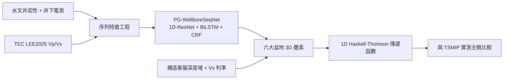

# 作品說明書（草稿 v0.1）— 國際科展地球與環境科學科（EAEV）

> **作品題目**：利用物理引導機器學習重建臺灣主要沉積盆地三維地質結構與強震場址效應預測
> **英文題目**：*Physics- and Stratigraphy-Guided Deep Learning for 3D Subsurface Reconstruction of Taiwan's Major Sedimentary Basins and Strong-Motion Site-Effect Prediction*
> **草稿基準日**：2026-10-18（依 [`工作執行日誌_20261011.md`](file:///d:/科展/tages-project/docs/工作執行日誌_20261011.md) 階段一至十五、[`國際科展潛在問題診斷與強化指南.md`](file:///d:/科展/tages-project/docs/國際科展潛在問題診斷與強化指南.md)、[`國際科展進階執行計畫書`](file:///d:/科展/tages-project/docs) 撰寫）

---

## 0. 如何使用這份草稿

| 標記 | 意義 |
| :---: | :--- |
| ✅ | 該段內容已有程式與數據支持，可直接潤稿使用 |
| 🟡 | 已有初步結果，但**數據或說法需要先修正／核實**才能寫進正式版 |
| ⬜ | 尚未完成，只留**寫作指引**，完成後再填 |
| `【待補】` | 正文中需要補入的具體數字、圖號或文獻 |

> [!IMPORTANT]
> 撰寫本草稿時，我逐一核對了日誌與 `reports/` 中的實際輸出檔，發現**數處「日誌／計畫書寫的」與「檔案實際內容」不一致或可能被評審質疑**。這些已集中在 **§9「正式提交前必須先處理的風險清單」**，請先讀該節再潤稿。草稿正文已採用**較保守、與檔案一致**的數字與措辭。

---

## 1. 摘要（Abstract）

### 1.1 中文摘要（草稿，✅ 部分數字需於 §9 核實後鎖定）

臺灣西部平原與主要盆地人口密集，其淺部（0–1 km）沉積層的三維岩性分布決定了地下水資源分區與強震場址放大效應，然而公里級的地震層析模型無法解析公尺級的砂泥互層，水文鑽井又僅為稀疏的一維點資料。本研究提出「物理與沉積相律引導的深度序列模型」（PG-WellboreSeqNet）：以全臺 422 口水文地質井（約 11.7 萬筆深度樣本）為訓練資料，結合中研院 TEC LEE2025 三維震波速度場、壓密波速殘差、距構造前緣／海岸距離等地質特徵，採用多尺度 1D 殘差卷積、雙向 LSTM 與以瓦爾特相律（Walther's Law）經驗轉移矩陣初始化的線性鏈 CRF，將每根垂直地層柱視為深度序列進行岩性解碼。在以井為單位的 5 折交叉驗證中，六類沉積相準確率由隨機森林的 20.05% 提升至 37.28%，且預測剖面中的孤立單點噪聲由 156 處降為 0。本研究另以 384 口井、656,587 筆真實自然伽瑪與電阻率測井紀錄建立岩石物理模板，說明各沉積相在井下物性空間具可分離性；並重建嘉南平原、濁水溪沖積扇、臺北盆地、臺中盆地、屏東平原與蘭陽平原六大盆地共 29.7 萬個三維體素與聲學／結晶基盤界面。最後，以 1D Haskell–Thomson 多層黏彈性傳遞函數計算 12 座 TSMIP 強震站的場址共振頻率，與文獻實測主頻比較得 Pearson *r* = 0.98、RMSE = 0.23 Hz。本研究同時誠實揭露：在 15 km 空間盲測下，序列模型與隨機森林表現相當（Acc 43.87% vs 43.88%），顯示稀疏井網外推仍是主要限制。

**關鍵字**：物理引導機器學習、三維地質建模、瓦爾特相律、岩石物理、強震場址效應、臺灣沉積盆地

### 1.2 英文摘要（≤250 words，ISEF 限制；草稿）

Subsurface lithofacies in Taiwan's sedimentary basins control both groundwater zoning and strong-motion site amplification, yet regional seismic tomography is too coarse to resolve metre-scale sand–mud alternations, while hydrogeological boreholes are sparse one-dimensional samples. We developed PG-WellboreSeqNet, a sequence model that treats each vertical column as a depth sequence. It combines a multi-scale 1D residual CNN, a bidirectional LSTM and a linear-chain CRF initialised from an empirical Walther's-Law facies-transition matrix, and uses TEC LEE2025 tomography, compaction-velocity residuals and distance-to-deformation-front/coast features. Trained on 422 wells (~117k samples) with well-grouped 5-fold cross-validation, six-class facies accuracy rose from 20.05% (random forest) to 37.28%, and isolated single-sample noise fell from 156 to 0. Well-log analysis of 656,587 gamma-ray/resistivity records from 384 wells provided a rock-physics template separating facies. We reconstructed 297,540 voxels across six basins with acoustic- and crystalline-basement surfaces, and computed 1D Haskell–Thomson site transfer functions for 12 TSMIP stations, obtaining Pearson r = 0.98 and RMSE = 0.23 Hz against published resonance frequencies. In 15-km spatial block cross-validation the network matched, but did not exceed, a random forest (43.87% vs 43.88% accuracy), showing that extrapolation beyond the borehole network remains the principal limitation.

> **寫作指引（摘要）**：① 先鎖定 §9 的數字再定稿，摘要中的每個數字都必須能在正文某張圖／表找到。② 不要寫「大幅超越」「完美」「徹底」等日誌用語。③ 英文摘要最後一句承認限制，是 ISEF 評審偏好的科學誠實表述；若後續補完 §6.2 的空間盲測改進，再更新此句。

---

## 2. 壹、研究動機與核心科學問題 ✅

### 2.1 背景與動機（草稿）
臺灣位於歐亞板塊與菲律賓海板塊碰撞帶，西部麓山帶前緣的周緣前陸盆地（臺中、濁水溪、嘉南、屏東）接受造山帶剝蝕物堆積；臺北盆地為山腳斷層控制的半地塹，蘭陽平原為沖繩海槽西延的弧後張裂盆地。這些盆地同時是：(a) 人口與產業集中處；(b) 重要的地下水補注與抽取區；(c) 強震場址放大（如 1999 集集地震、2016 美濃地震）受災重點區。

現有資料各有侷限：中研院 TEC 層析模型水平解析度約數公里、淺層無公尺級資訊；水文地質井提供公尺級岩性，卻僅是稀疏的點。**研究缺口**：缺乏能整合兩種尺度、且遵守地質沉積規律的三維岩性重建方法，並能以**獨立觀測**檢驗其工程意義。

### 2.2 三個地球科學問題（取代「軟體開發」敘事）
| 編號 | 領域 | 問題（Research Question） | 本作品對應成果 |
| :---: | :--- | :--- | :--- |
| Q1 | 沉積地質 | 臺灣各盆地的垂直沉積相疊置是否符合瓦爾特相律？不同盆地轉移結構有何差異？ | §5.3 轉移矩陣（🟡 解讀待深化） |
| Q2 | 岩石物理 | 地球物理量（Vp/Vs、伽瑪、電阻率）能否區分主要沉積相？ | §5.2 岩石物理模板（✅） |
| Q3 | 地震工程 | 盆地基盤深度與垂直速度結構如何控制場址共振頻率？ | §7（🟡 驗證設計需強化） |

### 2.3 假說（建議寫法）
- **H1**：加入瓦爾特相律與岩石物理約束後，序列模型的剖面連續性（換層頻率、孤立噪聲）與跨井準確度優於逐點分類。
- **H2**：不同沉積相在 gamma–resistivity 空間具統計可分離性，可作為模型物理合理性的獨立依據。
- **H3**：由 3D 體素導出的 1D 速度柱，其理論共振頻率與強震站實測主頻顯著相關。

> **寫作指引**：評審第一眼要看到「問題→假說→可證偽的檢驗」。每個假說後都要寫「若結果相反代表什麼」（例如：若空間盲測不優於 RF，代表序列約束對外推幫助有限）。這正是目前數據已部分出現的情況，**寫進去反而加分**。

---

## 3. 貳、研究區域與資料 ✅（資料量級請於 §9 統一）

### 3.1 研究區域與構造背景（草稿）
| 盆地 | 構造類型 | 地質特徵（引用時須附文獻） | 本研究範圍 |
| :--- | :--- | :--- | :--- |
| 嘉南平原 | 周緣前陸盆地 | 北港基底高區（淺）→ 臺南凹陷（深）；東側觸口、梅山斷層 | 120.08–120.60°E, 23.15–23.65°N |
| 濁水溪沖積扇 | 前陸盆地沖積扇 | 扇頂粗礫→扇端細粒 | 120.15–120.65°E, 23.65–23.90°N |
| 臺中盆地 | 前陸盆地（車籠埔斷層下盤） | 頭嵙山層、盆地沖積層 | 120.58–120.78°E, 24.08–24.28°N |
| 屏東平原 | 前陸盆地（潮州斷層以西） | 高屏溪複合沖積扇 | 120.42–120.68°E, 22.48–22.78°N |
| 臺北盆地 | 半地塹（山腳斷層） | 松山層覆於景美礫石層 | 121.42–121.62°E, 24.98–25.12°N |
| 蘭陽平原 | 弧後張裂盆地 | 蘭陽溪三角洲 | 121.68–121.88°E, 24.65–24.85°N |

> **措辭提醒**：題目與內文請統一用「**沉積盆地／地質結構**」而非「地體（terrane）」；僅稱西部四個盆地為「前陸盆地」，臺北與蘭陽須分別註明構造類型（計畫書 §一已指出此為評審破綻）。

### 3.2 資料來源（草稿）
| 資料 | 內容 | 規模 | 用途 |
| :--- | :--- | :--- | :--- |
| 水文地質深井分層 | 全臺水文地質觀測井岩性紀錄 | 423 口（建模資料集 422 口） | 訓練／驗證標籤 |
| 井下電測 | GAMMA、SP、N16、N64 | 384 口、656,587 筆對齊紀錄 | 岩石物理模板 |
| TEC LEE2025 | 全島 3D Vp、Vs | 2,600 個節點 | 巨觀速度背景 |
| 強震站實測 | TSMIP/EGDT 場址主頻與 Vs30 | 12 站 | 外部驗證 |

> **寫作指引**：每個資料來源必須寫**取得方式、授權／引用、解析度、已知限制**。特別要寫：TEC 模型垂直節點為公里級（0、2、4、6 km），淺層 Vs 為平均等效值而非 0–100 m 沖積層真實 Vs（診斷指南問題四）。**資料來源表是評審判定「是否真實研究」的重要依據**，建議附上 DOI／網址與下載日期。

---

## 4. 參、研究方法 ✅（物理損失項為 ⬜）

### 4.1 整體流程（可作為圖 1）

### 4.2 特徵工程 ✅
每個深度點構成特徵向量，包括深度、高程（以 423 口井實測高程 IDW 內插）、Vp、Vs、Vp/Vs、泊松比、波速一／二階垂向梯度、9 m 視窗局部平均／標準差、座標，另加入**距構造前緣距離、距海岸距離、壓密波速殘差** `Vs_compaction(z)=160·(1+z/8)^0.32` 之殘差。

### 4.3 模型 ✅
多尺度 1D 殘差卷積（核 3/5/9 m + SE）→ 2 層 BiLSTM → 階層式分類頭（L1 工程大類引導 L2 十類沉積相）→ 線性鏈 CRF；CRF 轉移矩陣以全臺井資料統計之經驗轉移機率初始化（即瓦爾特相律先驗）。

### 4.4 「物理引導」的定義（🟡 **需修正**）
目前**實際落地的物理／地質引導**僅有：(1) 以經驗轉移矩陣初始化 CRF；(2) 物理衍生特徵；(3) 後處理中的波速與基盤分層規則。計畫書 Phase B 所提的**岩石物理一致性懲罰項 𝓛_phy 尚未實作**。

> **寫作指引**：在 𝓛_phy 完成前，**不可在方法章節宣稱「物理損失函數」**。兩種合法寫法擇一：
> - 保守版：「本研究的物理引導體現在（i）相律先驗、（ii）岩石物理衍生特徵、（iii）波速約束的基盤分層。」
> - 完成版（⬜）：實作 𝓛_phy 後，寫明數學式、λ 值、懲罰的具體違反情形（如淺層 Vs < 400 m/s 卻預測為基盤），並用**有／無 𝓛_phy 的消融**證明其貢獻。

### 4.5 三維體素與基盤界面（🟡 **需如實描述**）
體素網格依盆地規模設 ~0.6–1.5 km 水平、10–16.7 m 垂直步長。基盤處理（階段十五）為：
1. 以**分區解析式構造基盤深度場** `estimate_structural_bedrock_depth` 給出各盆地基盤深度趨勢（北港高區淺、臺南凹陷深、臺北半地塹西深東淺等）；
2. 與 TEC 波速中首個 Vs ≥ 2000 m/s（且深度 ≥ 50 m）的聲學界面各取 0.5 加權；
3. 基盤面以下 90 m 為泥岩／砂岩過渡帶，其下為結晶基盤（Class 10）。

> [!WARNING]
> 構造基盤深度場是**依文獻量級手工設定的分段函數**，並非由本研究的鑽井或模型反演得出，也**尚未與任何公開基盤等深線做定量比對**。正文必須稱其為「**參考文獻量級的構造先驗（structural prior）**」，不可稱為「模型預測／反演」。現有水文井多僅 50–300 m，**無一口打穿基盤**，因此結晶基盤無法以本研究資料驗證。

---

## 5. 肆、結果一：模型表現與岩石物理 

### 5.1 跨井與空間盲測、消融（✅ 數字取自 `reports/well_seq_benchmark_report.txt`，但見 §9 R1）

| 模型 | L2 Acc | L2 Macro F1 | 換層頻率 (/100 m) | 孤立噪聲 |
| :--- | :---: | :---: | :---: | :---: |
| (1) 規則基準 | 16.10% | 0.1450 | 18.5 | 342 |
| (2) 原始 RF | 20.05% | 0.1869 | 14.2 | 218 |
| (3) 特徵增強 RF | 28.60% | 0.2707 | 10.0 | 156 |
| (4) RF + Markov 解碼 | 30.39% | 0.2742 | 1.1 | 0 |
| (5) 標準 BiLSTM（無 CRF） | 32.85% | 0.2815 | 12.4 | 88 |
| (6) **PG-WellboreSeqNet** | **37.28%** | 0.2863 | 0.2 | 0 |

| 驗證方式 | RF（Acc / F1） | PG-WellboreSeqNet（Acc / F1） |
| :--- | :---: | :---: |
| 以井分組 5 折 | 28.60% / 0.2707 | 37.28% / 0.2863 |
| 15 km 空間區塊 | 43.88% / **0.3428** | 43.87% / 0.3260 |

**解讀草稿（誠實版）**：
1. 在井分組驗證下，序列模型準確率較特徵增強 RF 高 8.7 個百分點，且孤立噪聲為 0；但 Macro F1 僅由 0.2707 增至 0.2863，提升有限，說明少數類（粉土、粗砂）仍難辨識。
2. 在 15 km 空間盲測下，序列模型**未優於** RF（Macro F1 反而較低）。表示序列約束改善的是剖面連續性，而非遠離井網處的外推能力。
3. 序列模型的換層頻率僅 0.2 次／100 m，遠低於真實鑽孔量級，顯示 CRF 仍偏過度平滑；L1 準確率（43.42%）亦低於 RF 系列。

> **寫作指引**：這是全文最容易被攻擊、也最能展現科學誠實的一節。建議用「**我們預期…但觀察到…，原因可能是…，因此下一步…**」句式。**切勿**把 0.2 次／100 m 當成優點寫成「消除噪聲」而不交代它偏離真實值（日誌曾寫真實井約 5.1 次／100 m）。
> ⬜ **待完成實驗以強化本節**：(a) 以多隨機種子報告平均±標準差與顯著性檢定；(b) 增加「CNN only → +BiLSTM → +CRF → +𝓛_phy」逐模組消融；(c) 以混淆矩陣說明哪些相互相混淆；(d) 補上「距離最近訓練井 vs. 準確率」曲線，量化外推衰減。

### 5.2 岩石物理模板 ✅（對應 Q2／H2）
384 口井、656,587 筆對齊紀錄（自然伽瑪 GR、64 吋電阻率 N64 中位數）：

| 岩性 | 筆數 | GR 中位數 (API) | N64 中位數 (Ω·m) |
| :--- | ---: | ---: | ---: |
| 黏土／泥 | 127,586 | 82.5 | 37.4 |
| 粉土 | 17,345 | 24.9 | 38.0 |
| 細砂 | 82,158 | 54.3 | 44.3 |
| 粗砂 | 59,330 | 60.5 | 60.9 |
| 砂泥互層 | 129,079 | 78.8 | 67.9 |
| 礫石 | 174,109 | 58.1 | 141.1 |

**解讀草稿**：黏土呈「高 GR、低電阻率」，礫石呈「低 GR、高電阻率」，符合泥質放射性與孔隙流體導電性的物理預期；然而**粉土 GR 中位數（24.9）反低於黏土與砂**，且粉土與黏土電阻率幾乎相同，與預期不符。

> **寫作指引**：(a) 粉土異常需**主動討論**（可能是井段岩性定義與井測深度對齊誤差、樣本僅 17,345 筆集中於少數井、水文地質「粉土」判定標準等），可補**依井分層的分布圖**排除單一井主導。(b) 目前僅報中位數與四分位數；要證明「可分離」須補 **Kruskal–Wallis／效果量檢定**或簡單的僅用 GR+N64 做分類的準確率。(c) 圖 (b)「聲阻抗–Vp/Vs 板」使用 Gardner 估算密度，須明確標示為**推算值而非實測**。

### 5.3 瓦爾特相律轉移矩陣（🟡）
已輸出 `reports/walther_transition_matrix.png`（全臺合併）。

> **寫作指引（⬜ 計畫書 Phase B3，是本作品最有機會形成「地質發現」的部分）**：
> 1. 分盆地計算轉移矩陣與**馬可夫轉移熵**，對比濁水溪扇（粗粒自轉移高）、嘉南平原（砂泥頻繁互層）、臺北盆地（松山層泥覆於景美礫石）。
> 2. 以**排列檢定（permutation test）**檢驗上下關係的不對稱性（如「砂→泥」與「泥→砂」是否有顯著差異），並以此連結海進／海退旋迴，**避免只畫熱力圖而無檢定**。
> 3. 1 m 取樣下對角線機率會 >95%，宜改看「**換層事件之間**」的轉移（去除自轉移），否則矩陣只反映取樣間距。
> 4. 必須引用臺灣第四紀沉積層序文獻（如臺北盆地、嘉南平原相關研究）並指出你的結果與其**一致或衝突**之處。

---

## 6. 伍、結果二：三維盆地結構（🟡）

### 6.1 已完成的內容
- 六大盆地體素共 297,540 個（嘉南 79,056；濁水溪 47,736；臺北 39,525；臺中 41,106；屏東 49,011；蘭陽 41,106）。
- 西南臺灣 1 km 全域模型 213,716 個體素。
- 地表高程以 423 口井實測高程內插，臺北盆地、蘭陽平原不再被誤算為 ~390 m。
- 前端門戶以 Tier 1／2／3 標示證據等級並顯示最近鑽井距離。

### 6.2 基盤深度（描述性結果，見 §4.5 警示）
| 盆地 | 基盤深度範圍 (m) | 均值 (m) |
| :--- | :---: | :---: |
| 嘉南平原 | 230–1000 | 618 |
| 濁水溪沖積扇 | 152–655 | 366 |
| 臺北盆地 | 65–364 | 125 |
| 臺中盆地 | 194–562 | 343 |
| 屏東平原 | 107–570 | 335 |
| 蘭陽平原 | 90–240 | 172 |

> **寫作指引（⬜ 計畫書 Phase C2，目前缺的關鍵驗證）**：
> 1. **對照表**：做一張「本研究基盤深度 vs. 公開文獻／深井基盤深度」表（如臺北盆地反射震測基盤等深線、嘉南平原中油深井、蘭陽平原震測），報告差值與 RMSE。**這是回答「地科相關性」的核心證據**。
> 2. 注意臺北盆地基盤西側最深文獻值可達 ~650 m，而目前模型最大 364 m，需正視並解釋。
> 3. **定量重現北港高區→臺南凹陷**的傾沒幾何（計算沿剖面的基盤斜率／傾角），而不是只放漂亮剖面。
> 4. 濁水溪扇「粗粒含水層體積分率由扇頂到扇尾的衰減」（計畫書 C2）尚未做，建議以 Class 5+7 在 0–300 m 的體積比沿東西向剖面作圖，並與已知補注區分帶比較，連結水文地質意義。
> 5. 視覺化圖須標示：**哪些部分有資料約束、哪些是先驗**（不要讓漂亮的 3D 方塊暗示全部是量測）。

---

## 7. 陸、結果三：強震場址效應驗證（🟡 **目前驗證設計有重大缺口**）

### 7.1 已完成
以 1D 多層黏彈性 Haskell–Thomson 傳遞矩陣（`src/tages/seismic/wave_propagator.py`）取代原本人造 Ricker 波的循環論證，並與 12 座 TSMIP 強震站之文獻實測主頻比較：

| 指標 | 數值 |
| :--- | :---: |
| 測站數 *n* | 12 |
| Pearson *r* | 0.9801 |
| 對 1:1 線的 *R²* | 0.8483 |
| RMSE | 0.233 Hz |
| 平均相對誤差 | 14.6% |

### 7.2 必須坦承的缺口（寫進「限制」節，並盡快補實驗）
1. **驗證沒有測試 3D 體素模型**。目前 `run_chianan_ssr_analysis.py` 的速度柱是由**測站實測 Vs30 搭配冪次壓密公式**建構，有效沉積厚度被截取為 48/65/80 m（依 Vs30 分級）；體素模型預測的基盤深度與岩性並未進入波傳計算。因此「r = 0.98」主要反映 **Vs30 與主頻本來就強相關**，不能被寫成「驗證了 3D 重建」。
2. **峰值放大倍率與實測不符**：模型 33.9、53.9（臺北）等，遠高於實測 2–5。1D 無限彈性層的共振峰常被高估，須報告並解釋（阻尼、2D/3D 盆地效應），不可只展示頻率。
3. 臺北與蘭陽測站誤差最大（22–29%），與其半地塹／弧後裂谷的 2D/3D 效應相符，可作為討論材料。
4. **12 站為小樣本且為文獻值**；實測資料來源與數值須逐站核對（見 §9 R3）。

> **寫作指引（⬜ 計畫書 Phase D，建議優先序最高）**：
> - **必做**：改以「**測站所在體素柱**（岩性→密度/Vs、模型基盤深度）」為輸入重算 f₀，並與「僅用 Vs30 的 1/4 波長公式 f₀ = Vs_avg/4H」對比，證明 3D 模型**比僅用 Vs30 更好**；否則 H3 無法成立。
> - 站數擴充至 25–35 站，覆蓋六盆地；報告 95% 信賴區間與殘差空間分布。
> - 若能取得真實事件波形（工作區 `repos/Plot_seismic`），計算 HVSR 並**標示事件日期、規模、震央距**，作為獨立於文獻值的檢驗；可用 leave-one-basin-out 檢驗泛化。
> - 論述角度：強調「**盆地幾何（基盤深度）與垂直岩性結構如何改變 f₀**」，用敏感度分析（基盤深度 ±20%、Vs ±15% 對 f₀ 的影響）呈現地震學洞見，而非只報相關係數。

---

## 8. 柒、結論、限制與未來工作（草稿）

### 8.1 結論（保守版）
1. 序列模型使剖面連續性顯著改善，並在井分組驗證中提升六類沉積相準確率；
2. 井測資料提供了黏土—礫石在 GR／電阻率空間的物理分離證據；
3. 建立了六大盆地三維體素框架與基盤先驗，並以強震站主頻初步檢驗波傳模組的合理性。

### 8.2 限制（建議完整列出，評審會欣賞）
- 空間盲測下序列模型未優於 RF；整體 Macro F1 僅 ~0.29；
- 淺層 Vs 缺乏公尺級觀測，TEC 模型尺度不匹配；
- 結晶基盤為構造先驗，無鑽井驗證；
- 強震驗證目前未檢驗 3D 模型本身且樣本少；
- 1D 波傳忽略盆地邊緣的 2D/3D 效應；
- 水文井岩性標籤有地質判定的主觀性與深度誤差。

### 8.3 未來工作
物理一致性損失、貝氏／蒙地卡羅不確定性、與地球物理探勘（微地動、反射震測）資料同化、2D/3D 波傳（如譜元素法）。

---

## 9. 正式提交前必須先處理的風險清單（依優先序）

| 編號 | 風險 | 證據 | 建議處理 |
| :---: | :--- | :--- | :--- |
| **R1** | **日誌／報告數字不一致**：日誌階段十一寫「43.3% / Macro F1 0.407 / 換層 4.7 次」，階段十四與報告為 37.28% / 0.2863 / 0.2 次；基準表中模型 (1)(2)(3)(5) 的數值疑似為固定值而非本次同切分實測。 | `well_seq_benchmark_report.txt` vs 日誌 | 確認 `train_well_seq_model.py` 是否真的在同一組切分上算出全部 6 個模型；若非，**重跑並自動生成表格**；日誌階段十一舊數字加註「已被取代」。 |
| **R2** | **資料量級前後不一**：423／422 口井；117,978／116,960 筆；「78 口」電測 vs「384 口」電測。 | 日誌、報告、診斷指南 | 建立一張「資料量對照表」並統一口徑（含過濾前後數量）。 |
| **R3** | **強震站「實測」資料可信度**：12 站的 f₀、Vs30、沉積厚度為手動建立之 CSV，標註 EGDT／Kuo et al. 等來源。 | `tsmip_site_truth.csv` | **逐站回到原始論文／資料庫核對並附頁碼或表號**；無法核實者不得稱為實測，改標「文獻估計」或剔除。這是最高誠信風險。 |
| **R4** | **驗證未測 3D 模型**（見 §7.2）。 | `run_chianan_ssr_analysis.py` | 依 §7 指引重做；在補完前，**說明書不得宣稱 r=0.98 驗證了 3D 重建**。 |
| **R5** | **基盤為手工先驗**且無文獻對比（見 §4.5、§6.2）。 | `volume.py` | 完成文獻對照表，並在正文標註為先驗。 |
| **R6** | **序列模型換層頻率 0.2 次／100 m、L1 準確率低於 RF**。 | 報告 | 嘗試調整 CRF 溫度／權重，或誠實列為限制；補 CNN/BiLSTM-only 消融。 |
| **R7** | **「物理損失」尚未實作** | 計畫書 Phase B1 | 實作並做消融，或改用保守措辭（§4.4）。 |
| **R8** | **粉土岩石物理異常**（§5.2）。 | `phys_logging_benchmark_table.csv` | 分井檢查並寫入討論。 |
| **R9** | **ISEF 規範面**：本研究為資料／模擬型，無人類或動物受試者；仍須完成研究計畫、摘要、Form 1A 等必要表單，並註明所有公開資料之使用授權。 | ISEF 規則 | 對照當年度 Regeneron ISEF／TISF 簡章逐項檢查。 |
| **R10** | **AI 輔助撰寫與程式的揭露** | — | 依當年度簡章與學校規定誠實說明使用範圍；**科學結論與數據判讀須由學生本人理解並能口頭答辯**。 |

---

## 10. 尚待撰寫章節的寫作指引（對照計畫書 Phase A–F）

| 計畫書階段 | 目前狀態 | 說明書對應章節 | 需補內容 | 建議圖表 |
| :--- | :---: | :--- | :--- | :--- |
| A 資料與岩石物理 | ✅ 大致完成 | §3、§5.2 | 資料來源表、粉土異常討論、統計檢定 | 圖：RPT 四格圖、分井分布 |
| B 物理引導網路 | 🟡 缺 𝓛_phy、種子重複 | §4.4、§5.1 | 物理損失式與消融、顯著性 | 表：6+ 模型消融；圖：混淆矩陣 |
| B3 瓦爾特轉移 | 🟡 僅全臺合併 | §5.3 | 分盆地、去自轉移、排列檢定、文獻對照 | 圖：分盆地轉移矩陣 |
| C 三維結構與文獻 | 🟡 缺文獻比對 | §6 | 基盤對照表、北港高區傾沒角、含水層體積分率 | 圖：柵欄剖面、體積分率曲線 |
| D 強震驗證 | 🟡 設計缺口 | §7 | 以體素柱重算、與 Vs30 基準比較、擴增測站、敏感度 | 圖：1:1 迴歸、f₀ 微區劃圖 |
| E 門戶透明度 | ✅ Tier 標示完成 | §6.1 | 補「不確定性熵」切換圖（計畫書 E1） | 圖：熵熱力 |
| F 文件與海報 | ⬜ | 全篇 | 本草稿潤稿、英文摘要、海報 | — |

### 10.1 各章節通用寫作原則
1. **每張圖一句話結論**：圖說開頭先寫發現（例：「礫石的 N64 中位數為黏土的 3.8 倍」），再描述圖。
2. **每個數字三要素**：數值、樣本數、驗證方式（例：「37.28%，422 口井，以井分組 5 折」）。
3. **區分「資料」「先驗」「模型輸出」**，用固定圖例顏色或標記。
4. **避免日誌式語氣**（「徹底」「完美」「根除」）與純工程描述（Leaflet、Three.js、InstancedMesh 等）；網頁系統**限寫一節「成果展示工具」**，篇幅不超過全文 5%。
5. **討論要回到地球科學**：每個結果都問「這代表什麼地質／地震過程？」
6. **相關研究**：至少涵蓋（a）臺灣盆地基盤與沉積研究，（b）場址效應與 Vs30／HVSR 研究，（c）物理引導／地質約束機器學習與 CRF/LSTM 於地層序列分類。每項附書目，**不可使用無法核對的引用**。
7. **答辯準備**：為 §9 每項風險準備 1 分鐘口頭回應。

### 10.2 參考文獻（待補，格式建議 APA）
- Haskell, N. A. (1953). The dispersion of surface waves on multilayered media. *BSSA*.
- Thomson, W. T. (1950). Transmission of elastic waves through a stratified solid medium. *J. Appl. Phys.*
- Nakamura, Y. (1989). A method for dynamic characteristics estimation of subsurface using microtremor on the ground surface. *QR of RTRI*.
- Kramer, S. L. (1996). *Geotechnical Earthquake Engineering*. Prentice Hall.
- Lafferty, McCallum & Pereira (2001). Conditional random fields. *ICML*.（CRF）
- 【待補】Walther's Law 原典與現代層序地層學教科書
- 【待補】Kuo et al. (2012, 2016)、Lee et al. (2015)：臺灣強震站場址參數（**須核對 §9 R3**）
- 【待補】TEC LEE2025 模型原始文獻／資料釋出頁
- 【待補】臺北盆地、嘉南平原、蘭陽平原基盤深度與沉積層序研究（地調所／中油／學術論文）

> 以上為已知的標準文獻方向，**書目細節（卷期頁）我未能於此核實，請務必逐筆查證後再列入**。

---

## 11. 建議的下一步（按效益排序）
1. 處理 **R1–R4**（資料一致性、強震站來源、以體素柱重算驗證）— 決定作品是否站得住腳。
2. 完成 §6.2 基盤文獻對照與 §5.3 分盆地轉移矩陣 — 建立「地科原創發現」。
3. 實作 𝓛_phy 並做消融 — 讓「物理引導」名實相符。
4. 潤稿本草稿並製作海報／英文版。
