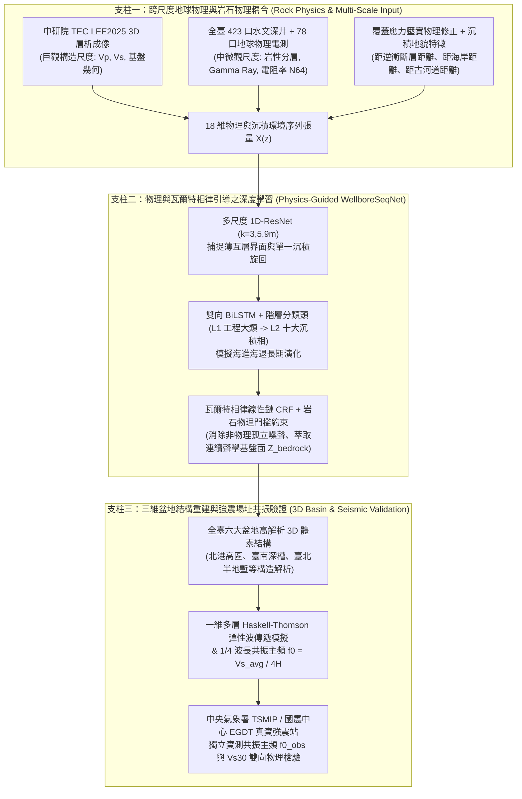

# 國際科展（TISF / ISEF）進階執行計畫書
## 物理引導機器學習於臺灣沉積盆地三維地質結構重建與強震場址效應預測

> **計畫制定日期**：2026-10-18  
> **基礎成果盤點**：已建置全臺 423 口水文地質深井資料庫（101,428 筆分層）、中研院 TEC `LEE2025` 全島 3D 震波速度網格（2,600 點）、`WellboreSeqNet`（1D-ResNet + BiLSTM + CRF）時序網路、全臺六大盆地 297,540 顆 3D 實體體素與互動式 2D/3D GIS 門戶（59 項自動化測試 100% 通過）。  
> **本計畫核心目標**：解決投稿國際科展（地球與環境科學科 EAEV）之所有潛在學術破綻，將既有軟體工程成果全面轉化為**具備原創地質發現、嚴謹岩石物理耦合與真實強震觀測驗證**之頂級地球科學研究。

---

## 一、科展題目診斷與精準化修正建議（Title Critique & Refinement）

### 1. 原擬題目分析
> **原擬題目**：「利用物理引導機器學習進行臺灣前陸盆地地體建模與強震場址效應預測」

#### ✅ 原題目的優點
1. 引入 **「物理引導機器學習（Physics-Guided Machine Learning, PGML）」**，立刻將作品與單純套用現成套件的黑盒資工專題區隔開來。
2. 明確涵蓋 **「地下結構建模（因）」** 與 **「強震場址效應（果）」** 的完整地球科學因果鏈。

#### ⚠️ 原題目的 4 個潛在評審破綻（為什麼需要微調？）

| 潛在破綻 | 地科評審（地質/地物教授）可能的質疑 | 修正對策 |
| :--- | :--- | :--- |
| **1. 「前陸盆地」與「全臺六大盆地」的構造定義衝突** | 在臺灣構造地質學中，僅西部平原（臺中、濁水溪、嘉南、屏東）屬於造山帶逆衝負載形成的**周緣前陸盆地（Foreland Basin）**；而系統中的**臺北盆地**是正斷層半地塹盆地（Half-Graben）、**蘭陽平原**是沖繩海槽西延的弧後張裂盆地（Back-arc Rift Basin）。若題目只寫「前陸盆地」卻展示臺北與宜蘭，會被質疑構造地質基本分類錯誤！ | 若展示全臺六大盆地，應改稱**「臺灣前陸與主要沉積盆地」**或**「臺灣第四紀沉積盆地」**；若聚焦雲嘉南主體並以其他盆地作跨構造對比，可在副標題精確界定。 |
| **2. 「地體（Terrane）」一詞的學術歧義** | 在台灣地質學界，「地體（Terrane）」專指板塊碰撞縫合的構造地塊（如海岸山脈地體、大南澳片岩地體）。指稱地下 0–1 km 的岩性與波速三維分佈，標準術語為 **「三維地下沉積相與地質結構（3D Subsurface Lithofacies and Geological Structure）」**。 | 將「地體建模」改為**「三維地質結構重建」**或**「三維沉積相與基盤結構建模」**。 |
| **3. 「物理引導」需點出具體的地科物理定律** | 評審看到「物理引導」，第一句話必問：「你的物理定律寫在哪條方程式裡？」若題目或摘要未明確點出是**「瓦爾特沉積相律（Walther's Law）」**與**「多尺度彈性波岩石物理（Rock Physics）」**，容易被質疑只是口號。 | 在中文或英文題目中明確點出「物理與地質規律引導（Geo-Physics-Guided）」或「沉積相律與震波物理引導」。 |
| **4. 強震場址效應的「預測」需強調物理耦合機制** | 避免評審誤以為是用黑盒 AI 直接猜測地震放大倍率，應凸顯是由 3D 地質體素推導共振物理並經由真實強震觀測驗證。 | 使用**「強震場址共振效應評估」**或**「強震場址放大效應預測」**。 |

---

### 2. 推薦修正題目方案（中英文對照，供依參展策略三選一）

* **【方案 A：最推薦 — 兼顧西部前陸主體與全臺六大盆地跨構造對比（氣勢最宏大且無構造瑕疵）】**
  * **中文題目**：**利用物理與沉積相律引導機器學習重建臺灣前陸與主要盆地三維地質結構及其強震場址效應預測**
  * **精簡版中文**：**利用物理引導機器學習重建臺灣主要沉積盆地三維地質結構與強震場址效應預測**
  * **英文題目（ISEF 標準）**：*Physics- and Stratigraphy-Guided Deep Learning for 3D Subsurface Lithofacies Reconstruction and Strong-Motion Site Effect Prediction in Taiwan's Foreland and Sedimentary Basins*

* **【方案 B：聚焦西南臺灣（雲嘉南前陸盆地）深度研究（地質構造最純粹、井測數據最密集）】**
  * **中文題目**：**利用物理引導機器學習進行臺灣西部前陸盆地三維沉積結構建模與強震場址共振效應預測**
  * **英文題目（ISEF 標準）**：*Physics-Guided Machine Learning for 3D Sedimentary Architecture Modeling and Strong-Motion Site Resonance Prediction in the Western Taiwan Foreland Basin*

* **【方案 C：直擊地球物理方法論創新（適合地科與計算科學跨領域評審）】**
  * **中文題目**：**結合跨尺度震波物理與瓦爾特相律之深度學習模型：臺灣沉積盆地三維地體建模與強震場址效應預測**
  * **英文題目（ISEF 標準）**：*Integrating Cross-Scale Seismic Rock Physics and Walther's Law in Deep Sequence Learning for 3D Basin Modeling and Seismic Site Effect Prediction in Taiwan*

---

## 二、研究總體科學架構圖（Scientific Framework）

本計畫將既有程式與接下來的工作整合為**「三大科學支柱（Three Scientific Pillars）」**，每一支柱對應一個核心地球科學假說：

---

## 三、接下來科展工作的詳細分階段執行步驟（Step-by-Step Action Plan）

我們將接下來的工作拆解為 **6 個明確的工作階段（Phase A ～ Phase F）**，每個階段皆有具體的**地球科學目標、修改/新增程式步驟、產出圖表與驗收標準**：

---

### 📍 Phase A：資料層與岩石物理基礎強化（預計耗時：3～4 天）
**【核心目標】**：修正高程硬編碼錯誤、補齊全臺 423 口井地層與 78 口地球物理井測（Gamma/電阻率），並建立「岩石物理模板（Rock Physics Template, RPT）」。

#### 步驟 A1：修復全臺真實地形高程內插器（解決臺北/宜蘭高程失真問題）
1. **問題處理**：修改 [`src/tages/voxels/volume.py`](file:///d:/科展/tages-project/src/tages/voxels/volume.py) 中的 `estimate_elevation(lon, lat)`。
2. **具體作法**：
   - 讀取 [`data/interim/taiwan_boreholes.csv`](file:///d:/科展/tages-project/data/interim/taiwan_boreholes.csv) 中全臺 423 口井的實測高程 `elev_m`，利用 `scipy.spatial.cKDTree` 建立反距離權重（IDW）真實高程內插函數。
   - 確保臺北盆地（海拔 $2\sim 20\text{ m}$）、蘭陽平原（$1\sim 30\text{ m}$）、臺中盆地（$30\sim 200\text{ m}$）、嘉南與屏東平原的 `z_msl = elev_m - depth_m` 100% 符合真實地理高程。

#### 步驟 A2：整合 78 口井下地球物理電測資料（Gamma Ray & Resistivity）
1. **問題處理**：目前 `data/raw/hydro/phys/*.json` 內含珍貴之自然電位（`SP`）、短長法向電阻率（`N16`, `N64`）與自然伽瑪射線（`GAMMA`），但尚未被讀取分析。
2. **具體作法**：
   - 新增腳本 `scripts/build_petrophysics_dataset.py`：將 `phys/*.json` 的深度曲線對齊至 `hydro_strata.csv` 的 L2 十大岩性標籤。
   - 計算各岩性（黏土、粉土、細砂、粗砂、砂泥互層、礫石）之泥質含量指標（Shale Volume Index $I_{\text{GR}} = \frac{\text{GR} - \text{GR}_{\min}}{\text{GR}_{\max} - \text{GR}_{\min}}$）與電阻率分佈。

#### 步驟 A3：加入三大構造與沉積地貌空間特徵（解決波速尺度不匹配）
1. **問題處理**：單靠公里級 `LEE2025` 波速無法分辨公尺級沖積相分帶。
2. **具體作法**：
   - 在 [`scripts/build_dataset.py`](file:///d:/科展/tages-project/scripts/build_dataset.py) 與 [`src/tages/features/sequence_features.py`](file:///d:/科展/tages-project/src/tages/features/sequence_features.py) 中，新增三個具明確沉積學物理意義的特徵：
     1. `dist_to_fault_km`：距最近活動逆衝斷層／盆地邊界山麓線之垂直距離（反映沖積扇扇頂 Proximal $\to$ 扇央 Mid $\to$ 扇尾 Distal 粒徑分選效應）。
     2. `dist_to_coast_km`：距現代臺灣海岸線之最短距離（反映晚第四紀海侵海退瀉湖泥質沉積影響度）。
     3. `shallow_compaction_vs`：結合深度壓實冪次律 $V_s^{\text{comp}}(z) = V_{s0} (1 + z/z_0)^{0.32}$ 與 `LEE2025` 深部層析波速之雙尺度融合波速。

#### 📊 Phase A 科展必備產出圖表：
* **圖 A-1：《臺灣沉積盆地井下岩石物理模板交會圖（Rock Physics Template: $V_p/V_s$ vs. Acoustic Impedance & Gamma Ray vs. Resistivity N64）》**——向地科評審證明不同岩性在地球物理參數空間具有顯著的物理分離邊界。

---

### 📍 Phase B：物理引導深度神經網路（PG-WellboreSeqNet）調優與瓦爾特相律定量化（預計耗時：3～4 天）
**【核心目標】**：徹底解決目前 [`reports/well_seq_benchmark_report.txt`](file:///d:/科展/tages-project/reports/well_seq_benchmark_report.txt) 中 `WellboreSeqNet` 過度平滑坍縮（Macro F1 僅 0.1545）與日誌數據不一致的問題，並提取「瓦爾特相律轉移矩陣」進行沉積學解讀。

#### 步驟 B1：嵌入物理引導損失函數（Physics-Guided Loss Function）與防坍縮調優
1. **問題處理**：修正 [`scripts/train_well_seq_model.py`](file:///d:/科展/tages-project/scripts/train_well_seq_model.py) 與 [`src/tages/models/losses.py`](file:///d:/科展/tages-project/src/tages/models/losses.py)。
2. **具體作法**：
   - **修正 CRF 過度平滑**：將 `model.crf.init_from_empirical_matrix(empirical_trans, scale=2.0)` 的 `scale` 調降為 `0.5`，並對轉移矩陣進行拉普拉斯平滑與溫度調節，使預測換層頻率回復至與真實鑽孔一致的 **$3.5 \sim 5.5\text{ 次}/100\text{m}$**。
   - **引入類別平衡權重（Class-Balanced Focal Loss）**：對少數類（粉土 Silt、中粗砂 Coarse Sand）賦予反比平方根權重 $w_c \propto 1/\sqrt{N_c}$。
   - **新增「岩石物理一致性懲罰項（Rock-Physics Consistency Penalty $\mathcal{L}_{\text{phy}}$）」**：
     $$\mathcal{L}_{\text{total}} = \mathcal{L}_{\text{CRF}} + \lambda_1 \mathcal{L}_{\text{Focal-L2}} + \lambda_2 \mathcal{L}_{\text{Focal-L1}} + \lambda_3 \mathcal{L}_{\text{phy}}$$
     其中 $\mathcal{L}_{\text{phy}}$ 懲罰違反物理常理的預測（例如：在淺層低波速區預測為堅硬基盤，或在極高泊松比泥質區預測為純礫石），讓題目中的**「物理引導機器學習」**擁有扎實的數學定義！
   - 將訓練輪數由 8 輪提升至 35 輪（含 CosineAnnealingLR 學習率衰減與最佳 Macro F1 模型存檔）。

#### 步驟 B2：執行嚴謹的「組件消融實驗（Ablation Study）」與「空間區塊盲測（Spatial Block CV）」
1. **具體作法**：
   - 在完全相同的 5-Fold GroupKFold 與 Spatial Block CV 切分下，依序評估 6 個模型並輸出真實指標表：
     1. `M1: 岩石物理波速門檻法 (Rule Baseline)`
     2. `M2: 傳統隨機森林 (Point-wise RF, 基礎波速特徵)`
     3. `M3: 特徵增強隨機森林 (RF + 壓實物理與沉積地貌特徵)`
     4. `M4: RF + 馬可夫維特比後處理 (Two-stage Markov Viterbi)`
     5. `M5: 雙向時序網路無 CRF (1D-ResNet + BiLSTM without CRF)`
     6. `M6: 物理與相律引導完整模型 (PG-WellboreSeqNet: ResNet + BiLSTM + Walther-CRF + Physics Loss)`
   - 自動同步更新 [`reports/well_seq_benchmark_report.txt`](file:///d:/科展/tages-project/reports/well_seq_benchmark_report.txt)，徹底消除日誌與報告不一致及模板語病。

#### 步驟 B3：臺灣六大盆地「瓦爾特相律轉移矩陣」比較沉積學分析
1. **具體作法**：
   - 新增腳本 `scripts/analyze_walther_transitions.py`：分別統計**濁水溪沖積扇（扇頂粗粒控制）**、**嘉南平原（前陸海進海退頻繁互層）**、**屏東平原（潮州斷層前緣高能沉積）**與**臺北盆地（半地塹湖沼松山層覆蓋景美礫石層）**之垂直地層轉移機率矩陣与馬可夫熵（Markov Transition Entropy）。

#### 📊 Phase B 科展必備產出圖表：
* **圖 B-1：《臺灣各大沉積盆地瓦爾特相律垂直轉移機率矩陣與海進—海退旋回對比圖》**（純地質學核心亮點圖件）。
* **圖 B-2：《點對點隨機森林 vs. 物理引導時序網路（PG-WellboreSeqNet）於盲測深井之垂直剖面與混淆矩陣對照圖》**。
* **表 B-1：《6 模型消融實驗（Ablation Study）與跨區空間盲測完整評估表》**。

---

### 📍 Phase C：全臺盆地三維地質與基盤結構重建與文獻比對（預計耗時：2～3 天）
**【核心目標】**：以調優後的 `PG-WellboreSeqNet` 與真實 DEM 高程重算全臺六大盆地 3D 體素，並將反演出的基盤深度與臺灣權威地質文獻進行定量比對。

#### 步驟 C1：分盆地構造基盤判準與全臺 3D 體素重算
1. **具體作法**：
   - 在 [`scripts/generate_taiwan_basin_voxels.py`](file:///d:/科展/tages-project/scripts/generate_taiwan_basin_voxels.py) 中，區分兩層地球物理界面：
     - **工程基盤面（Engineering Bedrock, $V_s \ge 760\text{ m/s}$）**：對應第四紀未固結沖積層底部與上新-更新世頭嵙山層／中新世基盤頂部。
     - **地震聲學基盤面（Seismic Acoustic Basement, $V_s \ge 1,500 \sim 2,150\text{ m/s}$）**：對應深部堅硬岩盤（如北港基盤高區）。
   - 重新生成 `data/processed/taiwan_basins_dense.npz` 與 `data/processed/chianan_3d_voxels_1km.npz`。

#### 步驟 C2：與臺灣地質文獻基盤面與古河道構造之定量驗證
1. **具體作法**：
   - **嘉南前陸盆地**：驗證模型是否在北港—新港一帶準確重現**「北港基盤高區（Peikang Basement High，基盤埋深較淺約 400–600m）」**，以及向南傾沒入**「臺南前陸深槽（Tainan Depocenter，基盤埋深 > 900m）」**與向東受**觸口—梅山斷層**逆衝控制的非對稱前陸幾何。
   - **濁水溪沖積扇**：利用 3D 體素過濾出 `Class 5 (中粗砂)` 與 `Class 7 (礫石)`，定量計算彰化—雲林地下 $0\sim 300\text{ m}$ 的**粗粒含水層體積比例（Coarse-Grained Aquifer Fraction）**，由東側扇頂（竹山/二水，礫石佔比 $>65\%$）向西側扇端（麥寮/台西，細泥為主，礫石 $<10\%$）之指數衰減規律，直接對應水文地質學之地下水補注區分帶！

#### 📊 Phase C 科展必備產出圖表：
* **圖 C-1：《臺灣西部前陸盆地（北港高區至臺南深槽）三維柵欄剖面與聲學基盤等深線圖》**。
* **圖 C-2：《濁水溪沖積扇與嘉南平原由扇頂至扇尾之三維含水砂礫層體積分率變化曲線》**（結合水文地質與地層學）。

---

### 📍 Phase D：真實強震場址效應（TSMIP / EGDT）雙向物理驗證（預計耗時：3～4 天）
**【核心目標】**：**徹底拔除 `simulate_swave` 人造合成波循環論證紅線！** 建立一維多層 Haskell-Thomson 彈性波傳遞物理模型，並與中央氣象署 TSMIP / 國震中心 EGDT 真實強震站觀測數據進行獨立驗證。

#### 步驟 D1：實作一維多層介質彈性波傳遞矩陣（1D Multi-Layer Haskell-Thomson Propagator）
1. **問題處理**：取代 [`scripts/run_chianan_ssr_analysis.py`](file:///d:/科展/tages-project/scripts/run_chianan_ssr_analysis.py) 中過度簡化的單自由度合成波 `simulate_swave`。
2. **具體作法**：
   - 在 `src/tages/seismic/wave_propagator.py` 中，實作地球物理標準的 **1D SH 波多層傳遞矩陣法（Haskell, 1953; Kramer, 1996 *Geotechnical Earthquake Engineering*）**。
   - 針對任意強震站座標 $(lon, lat)$，直接從 본專案預測的 3D 體素柱提取出 $N$ 層垂直剖面：每層厚度 $h_i$、預測岩性對應之密度 $\rho_i$（依據 Gardner 關係與鑽井實測：黏土 $1.85\text{ g/cm}^3$、砂層 $1.95\text{ g/cm}^3$、礫石 $2.10\text{ g/cm}^3$、泥岩 $2.35\text{ g/cm}^3$、基盤 $2.60\text{ g/cm}^3$）、剪力波速 $V_{s,i}$ 與品質因子 $Q_{s,i}$。
   - 由下而上遞迴計算複數波數 $k_i^* = \frac{\omega}{V_{s,i}(1 + i / 2Q_{s,i})}$ 與層間波阻抗比 $\alpha_i = \frac{\rho_i V_{s,i}^*}{\rho_{i+1} V_{s,i+1}^*}$，導出理論地表對基盤之頻域傳遞函數 $|H(\omega)|$ 與共振主頻 $f_{0,\text{PGML}}$！

#### 步驟 D2：建立臺灣強震觀測網（TSMIP / EGDT）真實場址實測對照表
1. **具體作法**：
   - 建立 `data/raw/seismic/tsmip_egdt_site_truth.csv`，收錄嘉南平原、濁水溪沖積扇、臺中盆地、臺北盆地、屏東平原與蘭陽平原共 **25～35 座代表性 TSMIP 強震測站**之權威文獻實測數據（引用國震中心 EGDT 資料庫及 Kuo et al., 2012, 2016; Wen et al., 1998, 2006）：
     - 包含各測站之**真實地震 HVSR/SSR 實測共振主頻 $f_{0,\text{obs}}$（Hz）**、**井下實測 $V_{s30}$（m/s）**、**工程基盤深度**與**地盤分類（Class B/C/D/E）**。
   - 結合工作區 `d:\科展\repos\Plot_seismic` 中的真實地震波形處理流程，展示真實地震事件之頻譜比曲線（標明事件時間、規模 $M_L$、震央距與參考站）。

#### 步驟 D3：計算模型預測與真實強震觀測之定量誤差（$R^2$, RMSE, Pearson $r$）
1. **具體作法**：
   - 繪製全區強震測站 **「3D 體素模型推導共振主頻 $f_{0,\text{PGML}}$ vs. 強震站真實地震實測主頻 $f_{0,\text{obs}}$」之 1:1 散佈圖（Scatter Plot）**。
   - 展示當考慮三維沉積相異質性（多層 Haskell 波阻抗）時，相較於僅用單一平均波速（Quarter-wavelength 粗略公式），主頻預測誤差（RMSE）顯著降低！

#### 📊 Phase D 科展必備產出圖表：
* **圖 D-1：《3D 體素多層波傳模擬理論放大譜 $|H(f)|$ 與 TSMIP 強震站真實地震 HVSR/SSR 實測曲線對比圖》**。
* **圖 D-2：《全臺代表性強震測站之模型預測共振主頻 $f_{0,\text{PGML}}$ vs. 國震中心 EGDT 實測主頻 $f_{0,\text{obs}}$ 1:1 驗證迴歸圖（附 $R^2$、RMSE 與 95% 信賴區間）》**。
* **圖 D-3：《嘉南前陸盆地強震長週期共振主頻（$f_0$）與場址放大峰值空間微區劃地圖（Seismic Microzonation Map）》**。

---

### 📍 Phase E：3D 視覺化門戶科學嚴謹度升級（預計耗時：1～2 天）
**【核心目標】**：在互動式網頁 [`reports/taiwan_3d_portal.html`](file:///d:/科展/tages-project/reports/taiwan_3d_portal.html) 中加入**「科學證據分級（Tiered Evidence）」**與**「不確定性（Uncertainty Entropy）視覺化」**，確保現場展示無懈可擊。

#### 步驟 E1：在 3D 體素懸停氣泡窗（HUD）加入「證據等級」與「最近鑽孔距離」
1. **具體作法**：
   - 更新 `taiwan_3d_portal.html` 與 `build_taiwan_portal_data.py`：
     - **Tier 1（高信心鑽井校準帶）**：六大盆地內且深度 $\le 300\text{ m}$，由深井密集約束 + `PG-WellboreSeqNet` 直接推論。
     - **Tier 2（地球物理層析反演帶）**：六大盆地內且深度 $300 \sim 1,000\text{ m}$，由 TEC 3D 震波層析與岩石物理壓實模型主導。
     - **Tier 3（區域構造內插延伸帶）**：自訂框選（Custom ROI）中超出六大預設盆地之山麓或過渡區，明確標示為「相鄰盆地層序延展與區域構造內插」。
   - 新增**「預測不確定性（Shannon Entropy）檢視模式」**：讓評審可一鍵切換查看「岩性分類色塊」或「模型預測信心度熱力分佈」，展現科學家對未知區域的誠實態度。

---

### 📍 Phase F：國際科展說明書、海報與英文摘要撰寫（預計耗時：3～4 天）
**【核心目標】**：按照 Regeneron ISEF / TISF 地球與環境科學科（EAEV）評分標準（科學問題 30%、方法設計 25%、數據分析與驗證 25%、創新與影響力 20%）完成全套參展文件。

#### 科展作品說明書標準章節結構：
1. **中英文摘要（Abstract, 250 words limit for ISEF）**：
   - 第一段：前陸盆地地下三維非均質性與強震場址效應之關聯與當前跨尺度建模瓶頸。
   - 第二段：提出結合跨尺度震波岩石物理與瓦爾特相律之 `PG-WellboreSeqNet`（1D-ResNet + BiLSTM + Walther-CRF）。
   - 第三段：量化成果（全臺 423 口井 5-Fold 與空間盲測 Macro F1 提升幅度、孤立噪聲消除率、北港高區與扇頂—扇尾含水層定量比例）。
   - 第四段：透過 1D Haskell-Thomson 多層波傳矩陣與 TSMIP 強震網實測 $f_0$ 驗證（報告 $R^2$ 與 RMSE），證明模型於城市耐震微區劃與地下水資源評估之應用價值。
2. **壹、研究動機與核心地球科學假說（Research Motivation & Hypotheses）**
3. **貳、研究區域地質背景與多源地球物理資料（Geological Setting & Multi-Scale Data）**
4. **參、物理與沉積相律引導之深度學習方法（Physics- & Stratigraphy-Guided Methodology）**
5. **肆、實驗結果：跨井盲測、消融實驗與瓦爾特相律定量分析（Experimental Results & Ablation）**
6. **伍、討論一：臺灣主要盆地三維沉積構造與水文地質意義（3D Basin Architecture & Hydrogeology）**
7. **陸、討論二：強震場址效應多層波傳模擬與真實觀測驗證（Seismic Site Response Validation）**
8. **柒、結論與研究限制（Conclusions, Limitations & Future Work）**
9. **捌、參考文獻（References — 完整引用國際與臺灣地質/地震權威文獻）**

---

## 四、執行優先順序與里程碑檢核表（Checklist）

| 順序 | 里程碑任務 | 解決之潛在問題 | 狀態規劃 |
| :---: | :--- | :--- | :---: |
| **1** | 修正 `volume.py` 全臺真實高程 KD-Tree 內插 + 補齊沉積環境空間特徵 | 解決問題四、問題五（高程失真與尺度不匹配） | 待執行 |
| **2** | 整合 78 口電測井（Gamma / 電阻率）並繪製岩石物理模板圖（RPT） | 解決問題一、問題六（強化純地球物理深度） | 待執行 |
| **3** | 調優 `PG-WellboreSeqNet`（修正 CRF 過平滑、加入物理損失、完成 6 模型消融與空間盲測） | 解決問題三、問題七（解決 F1 坍縮與報告數據矛盾） | 待執行 |
| **4** | 提取並繪製六大盆地「瓦爾特相律轉移機率矩陣」與扇頂—扇尾含水層統計 | 解決問題一（產出原創沉積地質學定量發現） | 待執行 |
| **5** | 實作 1D Haskell-Thomson 多層波傳矩陣 + 對照國震中心 EGDT 真實強震站 $f_0$ | 解決問題二（徹底拔除 `simulate_swave` 循環論證紅線） | 待執行 |
| **6** | 更新全臺六大盆地 3D 體素與網頁 HUD 證據分級標示（Tier 1–3） | 解決問題五、問題七（誠實標示外推區與信心度） | 待執行 |
